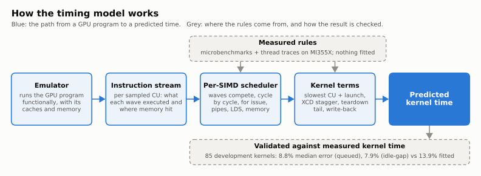
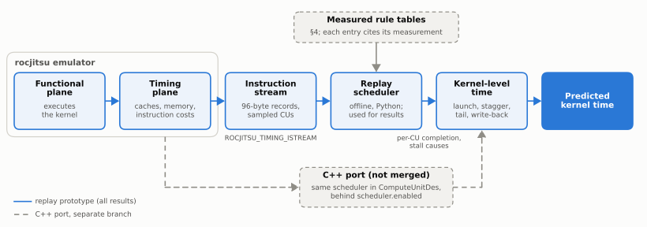
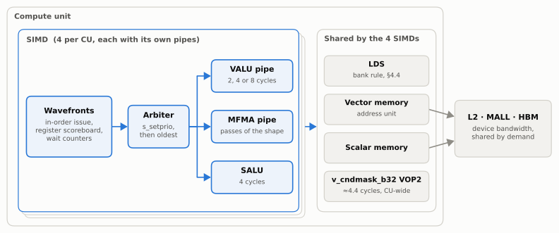
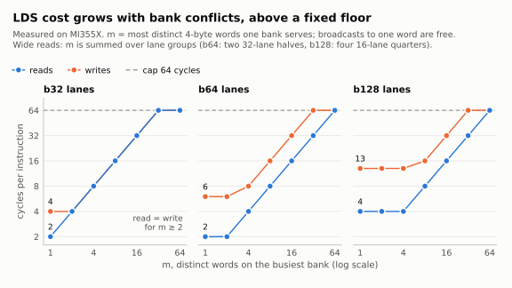
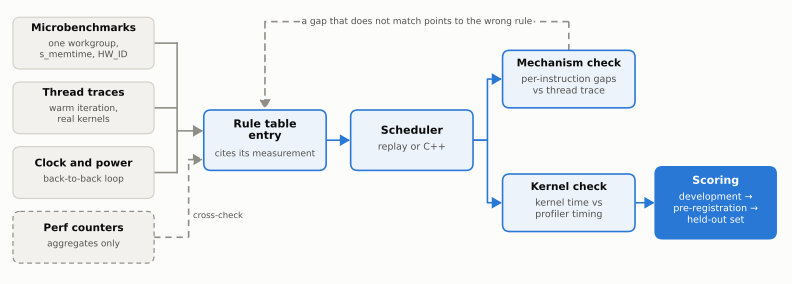
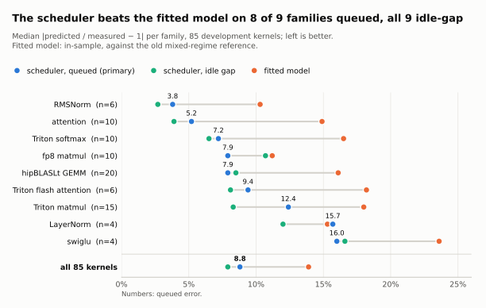

# Measured per-SIMD issue scheduler — design

A timing model for MI355X (gfx950) in which wavefronts compete for issue slots and execution pipes
cycle by cycle, and every rule is a measured hardware fact rather than a fitted knob.

## At a glance

| | |
| --- | --- |
| **What** | Replace the fitted closed-form composition of [timing.md](timing.md) with a per-SIMD scheduler plus measured kernel-level terms (launch, XCD stagger, teardown, write-back). |
| **Status** | **Prototype.** Runs as an offline replay over instruction streams exported by the emulator. A C++ port is in progress on a separate branch behind `scheduler.enabled` (default off), not merged. The shipped composition is unchanged. |
| **Headline (development data)** | 85 single-kernel items, median \|pred/meas − 1\| / share within 25%. **Queued reference (primary): 8.8% / 93%**, median ratio 0.94. Idle-gap reference: 7.9% / 94%. Nothing is fitted except one power limit ([§4.7](#47-occupancy-workgroup-launch-clock)). The shipped composition scores 13.9% / 69% *in-sample* (knobs fitted on this data, old mixed reference). |
| **Not yet** | No held-out score. Held-out set 9 will be scored against the queued reference ([§5.3](#53-the-reference-regime)). |

<p align="center"><picture><source media="(prefers-color-scheme: dark)" srcset="images/timing-measured-scheduler/overview-dark.svg"></picture></p>

## Contents

1. [Why change the composition](#1-why-change-the-composition)
2. [Architecture](#2-architecture)
3. [The scheduler](#3-the-scheduler)
4. [Measured rules (MI355X)](#4-measured-rules-mi355x)
5. [Kernel time](#5-kernel-time)
6. [Memory and replay corrections](#6-memory-and-replay-corrections)
7. [Implementation](#7-implementation)
8. [How rules are obtained and validated](#8-how-rules-are-obtained-and-validated)
9. [Results (development data)](#9-results-development-data)
10. [Open items and plan](#10-open-items-and-plan)

---

## 1. Why change the composition

The shipped model ([timing.md](timing.md)) keeps an independent timeline per wavefront slot and
composes a dispatch as

```text
fixed + max(issue, bandwidth, placement) + latency(exposed × rounds × latency_scale) + filling + flush
```

with about twenty knobs fitted by differential evolution against measured kernel times
([timing-variant-ranking.md](timing-variant-ranking.md)). On the development data this has two
structural problems:

| Problem | Effect |
| --- | --- |
| **Throughput and latency are summed.** The slowest wavefront's own issue slots are counted in both terms. | Kernels whose latency term is comparable to their throughput term are over-predicted by 16–45%: most hipBLASLt GEMMs, software-pipelined Triton matmuls, long-loop attention. The error grows with loop length — on aiter flash attention from 0 at S = 512 to +37% at S = 4096. |
| **Fitted knobs absorb structure, not physics.** `fixed_scale ≈ 0.03`, `unit.scalar_memory ≈ 0.002`, `level.mall ≈ 8.6e3`, `latency_scale ≈ 0.55` are not properties of the GPU. | They make the fit work on the families it saw and give no reason to expect them to hold on the next one. |

The alternative: model what the hardware does, and obtain each rule from a targeted measurement
rather than from end-to-end kernel time.

| | Shipped composition | Measured scheduler |
| --- | --- | --- |
| Overlap of issue, pipes, latency | Closed-form sum/max of per-dispatch terms | Emerges from cycle-by-cycle arbitration per SIMD |
| Parameters | ≈20 knobs fitted to kernel time | Rule tables, each entry from a microbenchmark or trace |
| Launch / teardown | Fitted `fixed` term | Measured head, XCD stagger, tail, write-back ([§5](#5-kernel-time)) |
| Explains a miss | Not per instruction | Every non-issue cycle has one cause |

## 2. Architecture

<p align="center"><picture><source media="(prefers-color-scheme: dark)" srcset="images/timing-measured-scheduler/architecture-dark.svg"></picture></p>

- The **emulator** runs the kernel functionally and, with the export enabled, writes one record per
  instruction of each sampled CU, including the memory level each access reached.
- The **replay** schedules those instructions on the machine of [§3](#3-the-scheduler) with the rules of
  [§4](#4-measured-rules-mi355x). It is kept outside the repo so rules stay cheap to change.
- The **C++ port** (dashed) moves the same scheduler into `ComputeUnitDes` ([§7.4](#74-c-port)).

## 3. The scheduler

### 3.1 Machine

<p align="center"><picture><source media="(prefers-color-scheme: dark)" srcset="images/timing-measured-scheduler/cu-machine-dark.svg"></picture></p>

| Resource | Scope | Occupancy |
| --- | --- | --- |
| Instruction arbiter | per SIMD | Each cycle each pipe accepts one instruction; highest `s_setprio` wins, then the oldest. |
| VALU pipe | per SIMD | 2, 4 or 8 cycles per mnemonic; transcendentals share this pipe. |
| MFMA pipe | per SIMD | Number of passes of the shape; each MFMA also holds the VALU pipe at issue. |
| SALU | per SIMD | 4 cycles |
| `v_cndmask_b32` (VOP2 form) | per CU | ≈4.4 cycles per instruction |
| LDS | per CU | Bank rule ([§4.4](#44-lds)) |
| Vector-memory address unit | per CU | Accesses per instruction ([§4.5](#45-vector-memory)) |
| Scalar memory | per CU | — |

Per wavefront the scheduler tracks:

- in-order issue, at most one instruction per **issue interval** (4 cycles; 4.6 for 8-byte encodings);
- a register **scoreboard** (VGPR / SGPR / AGPR): an instruction issues when its sources are ready;
- **wait counters**: `s_waitcnt` issues, then holds the wavefront until the named counters drain;
- **wave-local holds** for instructions that occupy the wavefront itself (branches, LDS writes,
  vector-memory issue, `s_nop`);
- workgroup **barriers**, released 4 cycles after the last live member arrives.

**Placement.** Wavefronts of a workgroup go to SIMDs round-robin; a workgroup launches when enough
wave slots are free. Workgroup *i* runs on XCD *i* mod 8; within an XCD, workgroups go round-robin
over shader engines and then CUs, so *i* and *i* + 256 share a CU.

### 3.2 One scheduling step

<p align="center"><picture><source media="(prefers-color-scheme: dark)" srcset="images/timing-measured-scheduler/scheduling-step-dark.svg"></picture></p>

Every cycle a wavefront does not issue is charged to exactly one cause: issue interval, register
dependency (by producer class), wait counter, pipe, barrier or arbitration. That attribution is what
the mechanism-level validation ([§8](#8-how-rules-are-obtained-and-validated)) compares against traces.

## 4. Measured rules (MI355X)

All values come from microbenchmarks unless marked *trace* (hardware thread trace of real kernels).
How they are measured: [§8](#8-how-rules-are-obtained-and-validated).

### 4.1 Issue and VALU

| Rule | Value |
| --- | --- |
| Wave issue interval | 4 cycles. A wave issuing only 8-byte encodings (VOP3/VOP3P/SDWA/DPP/literal) runs at ≈4.6; mixing in at least half 4-byte instructions hides this. |
| VALU occupancy 2 | `v_add/mul/fma/fmac_f32`, `v_mov_b32`, `v_add/sub_u32`, `v_and/or/xor_b32`, `v_lshrrev_b32` |
| VALU occupancy 4 | `v_pk_*`, `v_max3`, `v_cvt_pk_bf16_f32`, `v_cndmask`, `v_cmp`, `v_mov_b64`, `v_lshlrev`, `v_max_f32`, `v_div_*`, DPP |
| VALU occupancy 8 | `v_exp/rcp/log/sqrt/rsq_f32`; f32→fp8/bf8 conversions (packed, stochastic-rounding, scaled) and stochastic-rounding bf16; `v_permlane16/32_swap` |
| SGPR / VCC operand | Any VALU that reads or writes an SGPR or VCC loses double rate (2 → 4). A literal does not. |
| `v_cndmask_b32` VOP2 (e32/SDWA/DPP) | CU-shared, ≈4.4 cycles per instruction CU-wide (5.5 for a single wave). When saturated it also slows plain VALU on the other SIMDs to ≈16. The e64 form is normal. |
| Dependent latency | Never longer than the producer's own occupancy, independent of distance: VALU→VALU, MFMA srcC/srcA chains, MFMA→VALU, VALU→MFMA, transcendental chains. |
| Arbitration | Strict oldest-first; `s_setprio` overrides. |
| `s_nop N` | 4·(N+1) cycles |

### 4.2 MFMA

| Shape | Occupancy (cycles) |
| --- | --- |
| 32×32×16 bf16 / f16 / i8 | 32 |
| 16×16×32 bf16 / f16 / i8 | 16 |
| 32×32×64 f8f6f4 | 64 |
| 16×16×128 f8f6f4 | 32 |
| f32 32×32×2 / 16×16×4 | 64 / 32 |
| f64 16×16×4 / 4×4×4 | 64 / 16 |

Each MFMA holds the VALU pipe for 8 cycles at issue; for f32 and f64 inputs, occupancy + 8. (gfx950
has no xf32 MFMA.)

### 4.3 Control flow

| Rule | Value |
| --- | --- |
| Taken branch | ≈22 cycles near target; ≈46 when the target is a new fetch line; ≈350 on an instruction-cache miss |
| Not-taken branch | ≈8 cycles (≈11 right after `s_cmp`) |
| `s_barrier` | 4 + 4 × wavefronts per SIMD in lockstep; release 4 cycles after the last arrival |

### 4.4 LDS

Let *m* be the largest number of **distinct** 4-byte words that any one of the 64 banks serves for one
instruction. Lanes touching the same word share a pass, so a broadcast is free. Reads wider than 4 bytes
are served by **lane groups** — b64: two 32-lane halves, b128: four 16-lane quarters — and *m* is the
**sum over groups** of each group's own busiest-bank count of distinct words.

| Access | Occupancy (cycles, cap 64) |
| --- | --- |
| Read, 4-byte lanes | max(2, 2*m*) |
| Read, b64 lanes (also `ds_read_b64_tr_*` on the same addresses) | max(2, *m*), *m* summed over the 2 halves |
| Read, b128 lanes | max(4, *m*), *m* summed over the 4 quarters |
| Write b32 / b64 / b128 | max(4 / 6 / 13, 2*m*) |

From a 49-pattern microbenchmark; the emulator's LDS rule matches 105 of 110 measured patterns.

<p align="center"><picture><source media="(prefers-color-scheme: dark)" srcset="images/timing-measured-scheduler/lds-bank-cost-dark.svg"></picture></p>

Wave hold: writes ≈ bytes/40 (*trace*: 1 KiB writes cost 25–31 cycles in three kernels), b32 ≈ 8;
`b128` reads ≈ 8. Latency ≈ 52–60 cycles.

### 4.5 Vector memory

| Rule | Value |
| --- | --- |
| Address unit (per CU) | About one access per cycle. Dense global `dwordx4`: 16 cycles (64 B/clk). Scratch `dwordx4` / x2 / x1: 64 / 32 / 4, because the private segment is dword-swizzled — spill-heavy kernels are limited here. |
| Wave hold | Loads ≈ bytes/85 (≈12 for `x4`); stores ≈ bytes/51 |
| Multi-line load | A load touching *n* cache lines completes when its **slowest line** returns; with a fraction *f* of lines going far, it is far with probability 1 − (1 − *f*)<sup>*n*</sup>. |
| `vmcnt` order | Retires in program order across loads and stores. A wait after a store completes no earlier than the store's acknowledgement (≈290–300 cycles idle), even if later loads hit L1. |
| Load after an in-flight store, same address | No extra stall. A store covering a whole 64/128-byte unit keeps the L1 line valid; a partial-line store invalidates it, so the next load reads from L2. |

### 4.6 Caches and synchronisation

| Rule | Value |
| --- | --- |
| Vector L1 | 4 sets × 64 ways × 128 B, LRU. The set comes from a measured address hash (below); sets hold 9 / 9 / 7 / 7 of the 32 hash values, so contiguous data overflows the fullest set at 224 lines (≈28 KiB). Emulator: `l1_vector.set_hash = "mi355x"`. |
| L2 hit bandwidth | Device ≈14.6 KB/clk (113–115 requests/clk); per XCD ≈14.5 requests/clk; per CU at most ≈1 request/clk (a `dwordx4` holds the address unit 16 clk). |
| Outstanding L2 requests | ≈118 per CU, shared by hits and misses. |
| L2 load-to-use | ≈210 cycles + queueing inside the CU |
| Cache retention across kernels | Back-to-back launches keep L2 and MALL contents. Pointer chase per hop: ≈895 cycles cold, ≈215 on re-chase (L2 hit), ≈540 from MALL. Counter collection empties L2 before every dispatch and keeps MALL. |
| Cross-workgroup flag | A scalar store with `glc` is seen by a polling `s_load … glc` ≈1.3–1.5k cycles (≈550 ns) later. Each poll goes past L2: ≈400 or ≈700 cycles depending on the flag's address, with little same-XCD vs cross-XCD difference. Without `glc` the flag may never be seen. |

Vector-L1 set hash (reproduces every measured set membership and miss trace), with *L* = addr >> 7 and
*L*<sub>i</sub> its bit *i*:

```text
v0 = L0   v1 = L1   v2 = L2
v3 = L4 ^ L6 ^ L8 ^ L10 ^ L11 ^ L13
v4 = L3 ^ L4 ^ L5 ^ L6 ^ L7 ^ L9 ^ L11 ^ L12
if L mod 64 == 63 and (L6 == 0 or L9..L6 all 1):  v ^= 0b01100
set = table[v],  table = 0,2,1,0,3,1,2,0, 1,3,0,1,2,0,3,1, 2,0,3,0,1,3,0,2, 3,1,2,1,0,2,1,3
```

### 4.7 Occupancy, workgroup launch, clock

| Rule | Value |
| --- | --- |
| Occupancy (waves per CU) | min(32, 4·⌊512 / VGPRs⌋, ⌊3200 / SGPRs⌋, ⌊160 KiB / LDS⌋ · waves per workgroup), rounded down to whole workgroups |
| Slot release and relaunch (*trace*) | A wave's slot frees when its stores complete; the next workgroup launches ≈180 cycles later. |
| Saturated device | When device memory demand saturates bandwidth, a CU ends at the device time: other CUs use the bandwidth it leaves idle. |
| Sustained clock | 2383–2400 MHz on 91 of 95 development kernels; three dense fp8 GEMMs (1922–2260 MHz) and one bf16 matmul (2142 MHz) throttle. |
| Power-limited clock | f = 2400 MHz · √(*C* / *D*) when *D* > *C*, where *D* is the XCD dynamic power from measured per-operation energies: fp8 32×32×64 MFMA 27.6 nJ, bf16 32×32×16 MFMA 16.3 nJ, LDS 6.4 pJ/B, L2 19 pJ/B, HBM ≈25 pJ/B (at the XCD). |

**The power limit *C* is the one fitted value.** Sustained synthetic loads give *C* ≈ 525–550 W, but
real short kernels throttle only at *C* ≈ 760 W. That value is derived from the four throttled
development kernels (in-sample; leave-one-out error ≈50 MHz) and separates exactly those 4 of 95. An
independent basis for *C* is open ([§10](#10-open-items-and-plan)).

### 4.8 What changes against the shipped tuning

| Quantity | Shipped | Measured |
| --- | --- | --- |
| VALU result latency | 9–13 cycles | ≤ producer's occupancy |
| Transcendental | 12 cycles, own pipe | 8 cycles, VALU pipe |
| MFMA latency | fixed 44 | the MFMA's own occupancy |
| `s_nop N` | 1 | 4·(N+1) |
| Branches | not charged | [§4.3](#43-control-flow) |
| LDS bank conflicts | earlier rule | [§4.4](#44-lds) |
| L2 between dispatches | invalidated | kept |

## 5. Kernel time

The scheduler gives each sampled CU's completion. Kernel time adds measured launch and end terms
(bench microbenchmarks); these replace the earlier 1.8 µs launch floor.

### 5.1 Launched after an idle gap

Applies when the kernel starts after the GPU has been idle for at least ≈3 µs.

```text
start(XCD k)  = head + k × 0.18 µs                          k = 0..7 in start order
end           = max over XCDs [ start(XCD) + work(XCD) ]    work includes the workgroup-start ramp
kernel time   = end + teardown tail + release write-back
```

<p align="center"><picture><source media="(prefers-color-scheme: dark)" srcset="images/timing-measured-scheduler/launch-timeline-dark.svg"></picture></p>

| Term | Measured value |
| --- | --- |
| Head | 0.12 µs |
| XCD stagger | 8 XCDs start 0.18 µs apart; the last at +1.27 µs. Each XCD ends at its start + its work, so the **last-started XCD sets the end**. |
| Workgroup-start ramp (within an XCD) | 0.85 ns per workgroup + 0.46 ns per wavefront, over the first round |
| Teardown tail | 1.10 µs + 0.006 µs × resident wavefronts per CU (0.6 µs if only one XCD is used) |
| Release write-back | 0.115 µs per MB of dirty L2 at the end, saturating at ≈2.3 µs. Dirty bytes are the emulator's at release ([§6](#6-memory-and-replay-corrections)). |
| Minimum kernel | ≈3.4 µs with all 8 XCDs; 1.8 µs for one workgroup |

### 5.2 Queued behind another kernel

| Term | Measured value |
| --- | --- |
| Head + skew | ≈0.15 µs |
| Tail | ≈1.25 µs |
| Minimum kernel | ≈3.9 µs |

<p align="center"><picture><source media="(prefers-color-scheme: dark)" srcset="images/timing-measured-scheduler/launch-regimes-dark.svg"></picture></p>

On all 95 real development kernels, idle-gap launch is ≈0.96 µs slower than queued (median),
independent of how memory-bound the kernel is.

### 5.3 The reference regime

The earlier benchmark reference (`kernel_us`) mixed the two regimes: short kernels got 3–8 µs idle
gaps, longer ones ran with zero gap and paid ~63% of the stagger. It is replaced by regime-matched
measurements, each scored with the matching kernel rule.

**Decision: the primary metric uses kernels launched queued** (back to back, zero idle gap), for two
reasons:

- **Reproducible.** The gap is always 0. Idle-gap durations depend on the gap length — rmsnorm takes
  3.8–4.0 µs after 8–80 µs gaps but 4.5 µs after ≥160 µs.
- **Closer to production**, where kernels run from a stream or graph.

It was not chosen by model score: the model scores better on the idle-gap reference ([§9](#9-results-development-data)).
The idle-gap result is reported alongside; the two references differ by ≈0.96 µs per kernel, the XCD
stagger. Held-out set 9 will be scored queued.

### 5.4 Multi-kernel library calls

hipBLASLt split-K calls launch a GEMM followed by a PostGSU reduction. They are predicted as the sum of
both kernels, the second one queued ([§5.2](#52-queued-behind-another-kernel)). All 10 such calls in
the development data are within 16%.

## 6. Memory and replay corrections

Device read rates: ≈14.6 KB/clk for L2 hits ([§4.6](#46-caches-and-synchronisation)), ≈2700 B/clk beyond L2. Device write rates: ≈5200 for L2
hits, ≈2400 beyond L2. Each CU has one queue for reads and writes, served at most at its 64 B/clk
link; bandwidth is scaled by the device utilisation measured in a first pass, so a CU may burst while
the device is not saturated.

The replay adds four corrections, each because the emulator's execution order or bookkeeping differs
from hardware in a known way:

| Correction | Why | Replay rule |
| --- | --- | --- |
| **Beyond-L2 share rescaled** | The emulator runs workgroups in order, so the sampled CU holding workgroup 0 takes every compulsory miss. On hardware ~32 co-resident workgroups per XCD share them. Total bytes beyond L2 match hardware counters within ~1%; only the split is skewed. | Rescale each instruction's beyond-L2 share to the dispatch-wide total. |
| **Bandwidth shared by demand** | Equal per-CU shares throttled CUs holding two workgroups. | A CU holding *n* of *N* workgroups gets *n*/*N* of device bandwidth. |
| **Write-back from dirty bytes** | Per-lane write estimates counted masked-off rows, up to 20× too much. | Release write-back ([§5.1](#51-launched-after-an-idle-gap)) uses the emulator's dirty bytes at release. |
| **Stream-K spin collapse** | The emulator records 34–213 polls of a partner's flag (as many as its own timing produced); hardware runs 4–8. | Collapse the loop; hold the wave until the partner's flag, plus one poll (1400 cycles). |

The stream-K fix-up in hipBLASLt waits on a partner workgroup's flag:

<p align="center"><picture><source media="(prefers-color-scheme: dark)" srcset="images/timing-measured-scheduler/spin-collapse-dark.svg"></picture></p>

## 7. Implementation

### 7.1 Instruction-stream export (diagnostic)

`ROCJITSU_TIMING_ISTREAM=<prefix>` makes the timing plane write `<prefix>.<pid>`, a stream of fixed
96-byte records (`IStreamRecord`, `vm/timing/timing_plane.h`) for a sample of folded CUs.

| Setting | Meaning |
| --- | --- |
| `ROCJITSU_TIMING_ISTREAM_UNITS` | How many CUs to export |
| `ROCJITSU_TIMING_ISTREAM_STRIDE` | Unit *u* is exported when *u* mod stride = 0 |

Kernels whose work is uneven across workgroups (e.g. causal attention) need every CU sampled: their
time is set by the heaviest workgroup. The export is off by default and changes no timing.

| Record type | Contents |
| --- | --- |
| 0 instruction | class, unit, wait counter, slot, unfolded workgroup, port occupancy, result latency as the plane computed it, wait thresholds, register reads/writes, `s_setprio` priority, fetch stall, cache lines |
| 1 / 2 | wavefront begin / end |
| 3 | barrier member |
| 4 / 5 | dispatch acquire / end (aligns with `ROCJITSU_TIMING_TRACE` lines of the same pid) |
| 6 | first sighting of a pc: mnemonic, encoding size, `s_nop` immediate |
| 7 | file header (version) |

### 7.2 Emulator changes that come with it

| Change | Default | Effect |
| --- | --- | --- |
| `l2.keep_across_dispatches` | off; on in `gfx950_mi355x_measured.json` | L2 is not invalidated at dispatch acquire. |
| `lds.measured_banks` | off; on in `gfx950_mi355x_measured.json` | LDS bank rule of [§4.4](#44-lds), including the lane-group rule for wide reads. The per-pass issue floor no longer applies to LDS, because the rule prices the whole wavefront. |
| `l1_vector.set_hash` | `fold`; `"mi355x"` in `gfx950_mi355x_measured.json` | Vector-L1 set index from the measured hash of [§4.6](#46-caches-and-synchronisation). |
| CDNA4 kernarg preload | always | When the kernel descriptor enables preload, AQL dispatch enters 256 bytes past the descriptor's entry, skipping the compatibility prologue the firmware jumps over (a hardware thread trace shows the first instruction at entry + 0x100). Test: `AmdgpuVmTest.Cdna4KernargPreloadEntersPastFirmwareWindow`. |

### 7.3 Replay prototype

An offline replay (Python, kept with the measurement scripts, not in the repo) reads the export,
runs the scheduler on each sampled CU and reports wavefront lifetimes, the slowest CU's completion, and
the stall cause of every non-issue cycle ([§3.2](#32-one-scheduling-step)).

### 7.4 C++ port

`ComputeUnitDes` becomes an event-driven scheduler over the CU's resident wavefronts:

- the functional plane still delivers instructions at retire; the timing plane buffers each
  wavefront's stream and advances the CU's scheduler to the earliest cycle any wavefront can issue;
- per-SIMD pipes and per-CU ports carry `free_at` cycles; the arbiter picks by priority, then age;
- memory requests are issued to the plane at the scheduled cycle, so latency reflects contention
  among wavefronts on the same clock;
- each (workgroup, slot) gets its own wavefront state, so workgroups folded onto one CU do not share
  a timeline;
- `DispatchDes::end()` takes the duration from the scheduled CUs and the kernel-time terms of
  [§5](#5-kernel-time) instead of composing terms.

The rule tables become tuning data in the config, each entry citing its measurement; the shipped
composition stays selectable.

Port status: separate branch, behind `scheduler.enabled` (default off), 48 scheduler tests, not merged.
On 4 items it matches the Python replay within 1 cycle per CU.

| Part | Status |
| --- | --- |
| Issue, pipes, arbitration | ported |
| Scratch address unit, store acknowledgement | ported |
| Kernel-level time | ported |
| Stream-K spin collapse | ported |
| Per-pc averaged memory, two-pass memory queue | ported |
| Beyond-L2 rescaling, demand bandwidth share | ported |
| Occupancy limit, saturated device | ported |
| Slowest-line load completion | to port |
| Slot release at store completion, 180-cycle relaunch | to port |
| Outstanding-request cap (≈118 per CU) | to port |
| Power-limited clock | to port |

## 8. How rules are obtained and validated

<p align="center"><picture><source media="(prefers-color-scheme: dark)" srcset="images/timing-measured-scheduler/rules-validation-dark.svg"></picture></p>

| Source | Used for | Setup and caveats |
| --- | --- | --- |
| **Microbenchmarks** | Pipe occupancies, latencies, CU-shared resources, kernel-level terms | One workgroup of 1, 4, 8 or 16 wavefronts; inline-assembly body repeated in a loop; `s_memtime` per wavefront; `HW_ID` to verify SIMD placement. Per-SIMD occupancy = slowest wavefront's cycles / instructions issued on that SIMD. A CU-shared resource shows up as per-wavefront cost growing with the number of SIMDs running the instruction. One GPU, under the measurement guard. |
| **Hardware thread trace** (rocprofv3 `--att`) | Pattern-dependent costs: LDS writes, memory issue, branch-target fetch, spin-loop iteration counts | Trace a *warm* iteration (`--kernel-iteration-range`). Timestamps are comparable only within one shader engine. Tracing disturbs the memory system, so traces give per-wavefront and per-instruction shape, not kernel time. |
| **Performance counters** | Aggregate checks: instruction counts, bytes beyond L2, average memory latency | Collection empties L2 before each dispatch, so cache counts describe a cold dispatch. Never a timing reference. |
| **Clock and power** | Sustained clock, per-operation energies | Sampled during a back-to-back loop of each kernel; per-operation energies from sustained synthetic loads. |

**Nothing in [§4](#4-measured-rules-mi355x) or [§5](#5-kernel-time) is fitted to end-to-end kernel time**,
except the power limit *C* ([§4.7](#47-occupancy-workgroup-launch-clock)), which is set from the
measured clocks of the four throttled development kernels.

Validation, on development data only:

- **Mechanism level:** replay vs warm hardware thread traces, aligned by program order; each mnemonic's
  issue-to-next-issue gap is compared, which shows which rule is wrong.
- **Kernel level:** predicted kernel time vs the profiler's kernel timing (no tracing, no counters), warm
  caches, in the two launch regimes of [§5.3](#53-the-reference-regime): queued (primary) and after an
  idle gap.

The scheduler then goes through the existing protocol of
[timing-variant-ranking.md](timing-variant-ranking.md): development → pre-registration → one scoring of
a new held-out set.

## 9. Results (development data)

> Development data only, no held-out score. 85 single-kernel items; error = median |predicted /
> measured − 1|, plus the share within 25%. Nothing is fitted except the power limit *C*
> ([§4.7](#47-occupancy-workgroup-launch-clock)). The shipped composition's numbers are in-sample (its
> knobs were fitted on this data) and are against the old mixed-regime `kernel_us`.

| Reference ([§5.3](#53-the-reference-regime)) | Kernel rule | Median error | Within 25% | Median ratio |
| --- | --- | --- | --- | --- |
| **Queued (primary)** | queued ([§5.2](#52-queued-behind-another-kernel)) | **8.8%** | **93%** | 0.94 |
| Idle gap | idle gap ([§5.1](#51-launched-after-an-idle-gap)) | 7.9% | 94% | 0.95–0.96 |
| Shipped fitted composition | — (old mixed `kernel_us`, in-sample) | 13.9% | 69% | — |

Multi-kernel hipBLASLt calls (10, not in the 85) are all within 16% ([§5.4](#54-multi-kernel-library-calls)).

### 9.1 Rule by rule

Idle-gap reference unless noted; each step adds measured rules, nothing fitted except *C* in the last.

| Step | Median error | Within 25% |
| --- | --- | --- |
| Shipped fitted composition (in-sample, mixed `kernel_us`) | 13.9% | 69% |
| Measured scheduler with the LDS rule *(mixed `kernel_us`)* | 11.4% | 74% |
| + stream-K spin collapse *(mixed)* | 11.1% | 79% |
| + beyond-L2 rescaling *(mixed)* | 9.9% | 80% |
| + scratch address-unit cost and store acknowledgement *(mixed)* | 9.1% | 81% |
| + demand-proportional bandwidth *(mixed)* | 9.0% | 84% |
| + measured kernel-level terms, dirty-byte write-back *(mixed)* | 9.3% | 86% |
| **Reference changes to regime-matched (idle gap)** | 8.6% | 87% |
| + occupancy fix, saturated-device rule | 8.8% | 89% |
| + slowest-line latency, slot release at store completion + 180-cycle relaunch, ≤118 outstanding L2 requests per CU | 8.1% | 91% |
| + emulator LDS lane-group rule, vector-L1 set hash | 8.2% | 92% |
| + power-limited clock | **7.9%** | **94%** |
| Same model, queued reference and queued kernel rule | **8.8%** | **93%** |

<p align="center"><picture><source media="(prefers-color-scheme: dark)" srcset="images/timing-measured-scheduler/error-progression-dark.svg"></picture></p>

### 9.2 By family

<p align="center"><picture><source media="(prefers-color-scheme: dark)" srcset="images/timing-measured-scheduler/family-error-dark.svg"></picture></p>

| Family | n | Shipped (fitted, in-sample) | Scheduler, queued (primary) | Scheduler, idle gap |
| --- | --- | --- | --- | --- |
| RMSNorm | 6 | 10.3% | **3.8%** | 2.7% |
| attention | 10 | 14.9% | **5.2%** | 3.9% |
| Triton softmax | 10 | 16.5% | **7.2%** | 6.5% |
| fp8 matmul | 10 | 11.2% | **7.9%** | 10.7% |
| hipBLASLt GEMM | 20 | 16.1% | **7.9%** | 8.5% |
| Triton flash attention | 6 | 18.2% | **9.4%** | 8.1% |
| Triton matmul | 15 | 18.0% | **12.4%** | 8.3% |
| LayerNorm | 4 | 15.3% | **15.7%** | 12.0% |
| swiglu | 4 | 23.6% | **16.0%** | 16.6% |
| **all** | **85** | 13.9% (69%) | **8.8% (93%)** | 7.9% (94%) |

Causal attention is sampled on every CU.

**Known remaining error.**

- swiglu ≈16%, predicted too fast.
- LayerNorm 12–16% (n = 4).
- Triton matmul on the queued reference, 12.4% (8.3% idle gap).
- One fp8 kernel's LDS reads appear slower on hardware than modelled; to be measured.

## 10. Open items and plan

| Item | Status |
| --- | --- |
| Independent basis for the power limit *C* | Open: 760 W is set from the four throttled development kernels; sustained synthetic loads give 525–550 W ([§4.7](#47-occupancy-workgroup-launch-clock)). |
| swiglu, LayerNorm, Triton matmul (queued) | Open ([§9.2](#92-by-family)) |
| LDS reads of the slow fp8 kernel | To measure |
| Bandwidth in the last round of a grid that only partly fills the CUs | Not modelled |
| Instruction fetch beyond the branch rule | Not modelled |
| C++ port | Slowest-line rule, slot release / relaunch delay, outstanding-request cap, power clock still to port ([§7.4](#74-c-port)) |

Plan:

1. Port the remaining rules to C++ ([§7.4](#74-c-port)) and check it reproduces the replay on all items.
2. Pre-register, then score held-out set 9 once, against the queued reference.

The figures and diagrams (light and dark variants) are regenerated by
`images/timing-measured-scheduler/make_figures.py` from the summary numbers quoted in this document.
