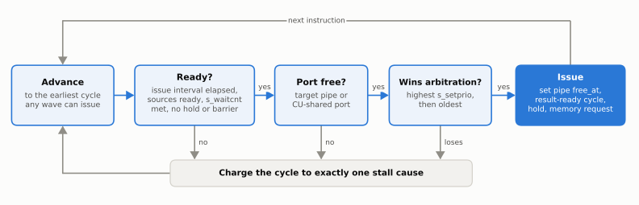
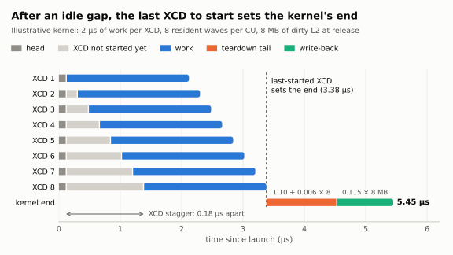
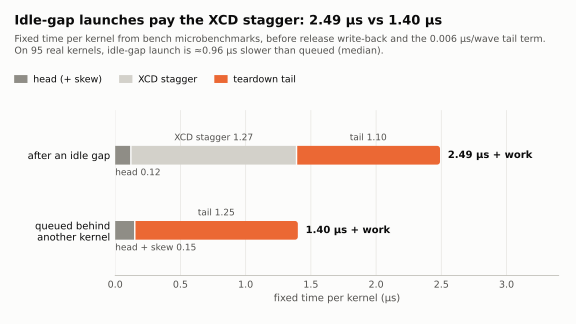
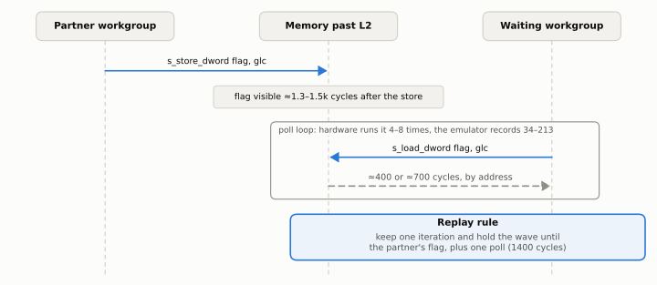
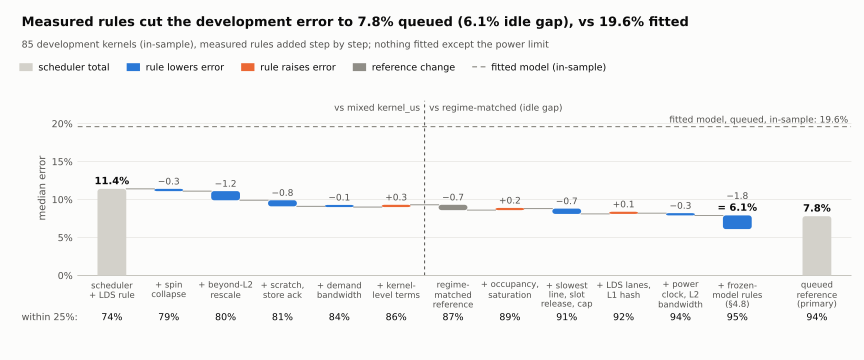

# Measured per-SIMD issue scheduler — design

A timing model for MI355X (gfx950) in which wavefronts compete for issue slots and execution pipes
cycle by cycle, and every rule is a measured hardware fact rather than a fitted knob.

## At a glance

| | |
| --- | --- |
| **What** | Replace the fitted closed-form composition of [timing.md](timing.md) with a per-SIMD scheduler plus measured kernel-level terms (launch, XCD stagger, teardown, write-back). |
| **Status** | **Prototype.** Runs as an offline replay over instruction streams exported by the emulator. A C++ port of the frozen model is on a separate branch behind `scheduler.enabled` (default off), not merged. It matches the replay within one cycle per CU and scores 7.8% / 94% queued on the development data, as the replay does. With the scheduler off, the shipped composition changes only through a wave-identity fix ([§7.4](#74-c-port)). |
| **Headline: held-out set 9, scored once** | 95 library calls on new shapes; model frozen and scoring pre-registered before the run ([§9.3](#93-held-out-set-9)). **Queued reference (primary): median \|pred/meas − 1\| 7.8%, 91% within 25%**, median ratio 0.96. Idle-gap reference: 7.3%, 94%, 0.96. |
| **Development data (in-sample)** | 85 single-kernel items: queued 7.8% / 94%, idle gap 6.1% / 95% ([§9.1](#91-development-data)). In the same metric, held-out is about one point worse than development (8.5% vs 7.8% queued). Nothing is fitted except one power limit, which an independent measurement confirms ([§4.7](#47-occupancy-workgroup-launch-clock)). The shipped fitted composition scores 19.6% / 56.5% on the same 85 items, also in-sample (its knobs were fitted on this data). |
| **Ranking** | On 5 tuning problems × 76 configs, the true best config is always in the model's top 3 ([§9.4](#94-ranking-test)). |

<p align="center"><picture><source media="(prefers-color-scheme: dark)" srcset="images/timing-measured-scheduler/overview-dark.svg"></picture></p>

## Contents

1. [Why change the composition](#1-why-change-the-composition)
2. [Architecture](#2-architecture)
3. [The scheduler](#3-the-scheduler)
4. [Measured rules (MI355X)](#4-measured-rules-mi355x)
5. [Kernel time](#5-kernel-time)
6. [Memory and replay corrections](#6-memory-and-replay-corrections)
7. [Implementation](#7-implementation)
8. [How rules are obtained and validated](#8-how-rules-are-obtained-and-validated)
9. [Results](#9-results)
10. [Open items and plan](#10-open-items-and-plan)

---

## 1. Why change the composition

The shipped model ([timing.md](timing.md)) keeps an independent timeline per wavefront slot and
composes a dispatch as

```text
fixed + max(issue, bandwidth, placement) + latency(exposed × rounds × latency_scale) + filling + flush
```

with about twenty knobs fitted by differential evolution against measured kernel times
([timing-variant-ranking.md](timing-variant-ranking.md)). On the development data this has two
structural problems:

| Problem | Effect |
| --- | --- |
| **Throughput and latency are summed.** The slowest wavefront's own issue slots are counted in both terms. | Kernels whose latency term is comparable to their throughput term are over-predicted by 16–45%: most hipBLASLt GEMMs, software-pipelined Triton matmuls, long-loop attention. The error grows with loop length — on aiter flash attention from 0 at S = 512 to +37% at S = 4096. |
| **Fitted knobs absorb structure, not physics.** `fixed_scale ≈ 0.03`, `unit.scalar_memory ≈ 0.002`, `level.mall ≈ 8.6e3`, `latency_scale ≈ 0.55` are not properties of the GPU. | They make the fit work on the families it saw and give no reason to expect them to hold on the next one. |

The alternative: model what the hardware does, and obtain each rule from a targeted measurement
rather than from end-to-end kernel time.

| | Shipped composition | Measured scheduler |
| --- | --- | --- |
| Overlap of issue, pipes, latency | Closed-form sum/max of per-dispatch terms | Emerges from cycle-by-cycle arbitration per SIMD |
| Parameters | ≈20 knobs fitted to kernel time | Rule tables, each entry from a microbenchmark or trace |
| Launch / teardown | Fitted `fixed` term | Measured head, XCD stagger, tail, write-back ([§5](#5-kernel-time)) |
| Explains a miss | Not per instruction | Every non-issue cycle has one cause |

## 2. Architecture

<p align="center"><picture><source media="(prefers-color-scheme: dark)" srcset="images/timing-measured-scheduler/architecture-dark.svg"></picture></p>

- The **emulator** runs the kernel functionally and, with the export enabled, writes one record per
  instruction of each sampled CU, including the memory level each access reached.
- The **replay** schedules those instructions on the machine of [§3](#3-the-scheduler) with the rules of
  [§4](#4-measured-rules-mi355x). It is kept outside the repo so rules stay cheap to change.
- The **C++ port** (dashed) moves the same scheduler into `ComputeUnitDes` ([§7.4](#74-c-port)).

## 3. The scheduler

### 3.1 Machine

<p align="center"><picture><source media="(prefers-color-scheme: dark)" srcset="images/timing-measured-scheduler/cu-machine-dark.svg"></picture></p>

| Resource | Scope | Occupancy |
| --- | --- | --- |
| Instruction arbiter | per SIMD | Each cycle each pipe accepts one instruction; highest `s_setprio` wins, then the oldest. |
| VALU pipe | per SIMD | 2, 4 or 8 cycles per mnemonic; transcendentals share this pipe. Two 2-cycle ops of different waves can share one 4-cycle VALU slot ([§4.8](#48-rules-added-for-the-frozen-model)). |
| MFMA pipe | per SIMD | Number of passes of the shape; each MFMA also holds the VALU pipe at issue. |
| SALU | per SIMD | 4 cycles |
| `v_cndmask_b32` (VOP2 form) | per CU | ≈4.4 cycles per instruction |
| LDS | per CU | Bank rule ([§4.4](#44-lds)) |
| Vector-memory address unit | per CU | Accesses per instruction ([§4.5](#45-vector-memory)) |
| Scalar memory | per CU | — |

Per wavefront the scheduler tracks:

- in-order issue, at most one instruction per **issue interval** (4 cycles; 4.6 for a run of 8-byte
  encodings; 4.8 / 8.2 for 8- / 16-byte LDS reads);
- a register **scoreboard** (VGPR / SGPR / AGPR): an instruction issues when its sources are ready;
- **wait counters**: `s_waitcnt` issues, then holds the wavefront until the named counters drain;
- **wave-local holds** for instructions that occupy the wavefront itself (branches, LDS writes,
  vector-memory issue, `s_nop`);
- workgroup **barriers**, released 4 cycles after the last live member arrives.

**Placement.** Each SIMD has a quarter of the CU's wave slots. A workgroup's wavefronts are spread
evenly over the SIMDs, and the workgroup launches when those SIMDs have room. Workgroup *i* runs on XCD *i* mod 8; within an XCD, workgroups go round-robin
over shader engines and then CUs, so *i* and *i* + 256 share a CU.

### 3.2 One scheduling step

<p align="center"><picture><source media="(prefers-color-scheme: dark)" srcset="images/timing-measured-scheduler/scheduling-step-dark.svg"></picture></p>

Every cycle a wavefront does not issue is charged to exactly one cause: issue interval, register
dependency (by producer class), wait counter, pipe, barrier or arbitration. That attribution is what
the mechanism-level validation ([§8](#8-how-rules-are-obtained-and-validated)) compares against traces.

## 4. Measured rules (MI355X)

All values come from microbenchmarks unless marked *trace* (hardware thread trace of real kernels).
How they are measured: [§8](#8-how-rules-are-obtained-and-validated).

### 4.1 Issue and VALU

| Rule | Value |
| --- | --- |
| Wave issue interval | 4 cycles. A wave issuing only 8-byte encodings (VOP3/VOP3P/SDWA/DPP/literal) runs at ≈4.6; mixing in at least half 4-byte instructions hides this. |
| VALU occupancy 2 | `v_add/mul/fma/fmac_f32`, `v_mov_b32`, `v_add/sub_u32`, `v_and/or/xor_b32`, `v_lshrrev_b32` |
| VALU occupancy 4 | `v_pk_*`, `v_max3`, `v_cvt_pk_bf16_f32`, `v_cndmask`, `v_cmp`, `v_mov_b64`, `v_lshlrev`, `v_max_f32`, `v_div_*`, DPP |
| VALU occupancy 8 | `v_exp/rcp/log/sqrt/rsq_f32`; f32→fp8/bf8 conversions (packed, stochastic-rounding, scaled) and stochastic-rounding bf16; `v_permlane16/32_swap` |
| SGPR / VCC operand | Any VALU that reads or writes an SGPR or VCC loses double rate (2 → 4). A literal does not. |
| `v_cndmask_b32` VOP2 (e32/SDWA/DPP) | CU-shared, ≈4.4 cycles per instruction CU-wide (5.5 for a single wave). When saturated it also slows plain VALU on the other SIMDs to ≈16. The e64 form is normal. |
| Dependent latency | Never longer than the producer's own occupancy, independent of distance: VALU→VALU, MFMA srcC/srcA chains, MFMA→VALU, VALU→MFMA, transcendental chains. |
| Arbitration | Strict oldest-first; `s_setprio` overrides. |
| `s_nop N` | 4·(N+1) cycles |

### 4.2 MFMA

| Shape | Occupancy (cycles) |
| --- | --- |
| 32×32×16 bf16 / f16 / i8 | 32 |
| 16×16×32 bf16 / f16 / i8 | 16 |
| 32×32×64 f8f6f4 | 64 |
| 16×16×128 f8f6f4 | 32 |
| f32 32×32×2 / 16×16×4 | 64 / 32 |
| f64 16×16×4 / 4×4×4 | 64 / 16 |

Each MFMA holds the VALU pipe for 8 cycles at issue; for f32 and f64 inputs, occupancy + 8. (gfx950
has no xf32 MFMA.)

### 4.3 Control flow

| Rule | Value |
| --- | --- |
| Taken branch | ≈22 cycles near target; ≈46 when the target is a new fetch line; ≈350 on an instruction-cache miss |
| Not-taken branch | ≈8 cycles (≈11 right after `s_cmp`) |
| `s_barrier` | 4 + 4 × wavefronts per SIMD in lockstep; release 4 cycles after the last arrival |

### 4.4 LDS

Let *m* be the largest number of **distinct** 4-byte words that any one of the 64 banks serves for one
instruction. Lanes touching the same word share a pass, so a broadcast is free. Reads wider than 4 bytes
are served by **lane groups** — b64: two 32-lane halves, b128: four 16-lane quarters — and *m* is the
**sum over groups** of each group's own busiest-bank count of distinct words.

| Access | Occupancy (cycles, cap 64) |
| --- | --- |
| Read, 4-byte lanes | max(2, 2*m*) |
| Read, b64 lanes (also `ds_read_b64_tr_*` on the same addresses) | max(2, *m*), *m* summed over the 2 halves |
| Read, b128 lanes | max(4, *m*), *m* summed over the 4 quarters |
| Write b32 / b64 / b128 | max(4 / 6 / 13, 2*m*) |

From a 49-pattern microbenchmark; the emulator's LDS rule matches 105 of 110 measured patterns.

<p align="center"><picture><source media="(prefers-color-scheme: dark)" srcset="images/timing-measured-scheduler/lds-bank-cost-dark.svg"></picture></p>

Wave hold: writes ≈ bytes/40 (*trace*: 1 KiB writes cost 25–31 cycles in three kernels), b32 ≈ 8;
`b128` reads ≈ 8. Latency ≈ 52–60 cycles.

| Other LDS traffic | Cost |
| --- | --- |
| `ds_bpermute_b32` / `ds_permute_b32` | 6 cycles of the CU's LDS; holds the wave 8.3 cycles |
| LDS-DMA load (`buffer_load … lds`, no VGPR destination) | 1 cycle of the CU's LDS, on top of its vector-memory cost |
| Issue interval of back-to-back reads | 4.8 cycles for 8-byte (`ds_read_b64*`), 8.2 for `ds_read_b128` |

### 4.5 Vector memory

| Rule | Value |
| --- | --- |
| Address unit (per CU) | About one access per cycle. Dense global `dwordx4`: 16 cycles (64 B/clk). Scratch `dwordx4` / x2 / x1: 64 / 32 / 4, because the private segment is dword-swizzled — spill-heavy kernels are limited here. |
| Wave hold | Loads ≈ bytes/85 (≈12 for `x4`); stores ≈ bytes/51 |
| Multi-line load | A load touching *n* cache lines completes when its **slowest line** returns; with a fraction *f* of lines going far, it is far with probability 1 − (1 − *f*)<sup>*n*</sup>. |
| `vmcnt` order | Retires in program order across loads and stores. A wait after a store completes no earlier than the store's acknowledgement (≈290–300 cycles idle), even if later loads hit L1. |
| Load after an in-flight store, same address | No extra stall. A store covering a whole 64/128-byte unit keeps the L1 line valid; a partial-line store invalidates it, so the next load reads from L2. |

### 4.6 Caches and synchronisation

| Rule | Value |
| --- | --- |
| Vector L1 | 4 sets × 64 ways × 128 B, LRU. The set comes from a measured address hash (below); sets hold 9 / 9 / 7 / 7 of the 32 hash values, so contiguous data overflows the fullest set at 224 lines (≈28 KiB). Emulator: `l1_vector.set_hash = "mi355x"`. |
| L2 hit bandwidth | Device ≈14.6 KB/clk (113–115 requests/clk); per XCD ≈14.5 requests/clk; per CU at most ≈1 request/clk (a `dwordx4` holds the address unit 16 clk). |
| Outstanding L2 requests | ≈118 per CU, shared by hits and misses. |
| L2 load-to-use | ≈210 cycles + queueing inside the CU |
| Cache retention across kernels | Back-to-back launches keep L2 and MALL contents. Pointer chase per hop: ≈895 cycles cold, ≈215 on re-chase (L2 hit), ≈540 from MALL. Counter collection empties L2 before every dispatch and keeps MALL. |
| Cross-workgroup flag | A scalar store with `glc` is seen by a polling `s_load … glc` ≈1.3–1.5k cycles (≈550 ns) later. Each poll goes past L2: ≈400 or ≈700 cycles depending on the flag's address, with little same-XCD vs cross-XCD difference. Without `glc` the flag may never be seen. |

Vector-L1 set hash (reproduces every measured set membership and miss trace), with *L* = addr >> 7 and
*L*<sub>i</sub> its bit *i*:

```text
v0 = L0   v1 = L1   v2 = L2
v3 = L4 ^ L6 ^ L8 ^ L10 ^ L11 ^ L13
v4 = L3 ^ L4 ^ L5 ^ L6 ^ L7 ^ L9 ^ L11 ^ L12
if L mod 64 == 63 and (L6 == 0 or L9..L6 all 1):  v ^= 0b01100
set = table[v],  table = 0,2,1,0,3,1,2,0, 1,3,0,1,2,0,3,1, 2,0,3,0,1,3,0,2, 3,1,2,1,0,2,1,3
```

### 4.7 Occupancy, workgroup launch, clock

| Rule | Value |
| --- | --- |
| Occupancy (waves per CU) | min(32, 4·⌊512 / VGPRs⌋, ⌊3200 / SGPRs⌋, ⌊160 KiB / LDS⌋ · waves per workgroup), rounded down to whole workgroups |
| Slot release and relaunch (*trace*) | A wave's slot frees when its stores complete; the next workgroup launches ≈180 cycles later. |
| Saturated device | When device memory demand saturates bandwidth, a CU ends at the device time: other CUs use the bandwidth it leaves idle. |
| Sustained clock | 2383–2400 MHz on 91 of 95 development kernels; three dense fp8 GEMMs (1922–2260 MHz) and one bf16 matmul (2142 MHz) throttle. |
| Power-limited clock | f = 2400 MHz · √(*C* / *D*) when *D* > *C*, where *D* is the XCD dynamic power from measured per-operation energies: fp8 32×32×64 MFMA 27.6 nJ, bf16 32×32×16 MFMA 16.3 nJ, LDS 6.4 pJ/B, L2 19 pJ/B, HBM ≈25 pJ/B (at the XCD). |

**The power limit *C* is the one fitted value.** *C* = 760 W is derived from the four throttled
development kernels (in-sample; leave-one-out error ≈50 MHz) and separates exactly those 4 of 95.
**An independent measurement agrees:** synthetic gap-free MFMA loads of 20–500 µs per kernel,
run until they throttle and scored with the same energy table, give *C* ≈ 761 W (median of 10).
The limit binds when the measured XCD power reaches ≈830–865 W.

Caveat: the energy table is not exact. Clean LDS and L2 loads measure ≈3.7 pJ/B for LDS and ≈14.3 pJ/B
for L2 hits, against 6.4 and 19 in the table, and about 20% of real-kernel power is not explained by
the table's operations. *C* and the table are consistent with each other, so the predicted clocks hold;
the individual energies should not be read as physical.

### 4.8 Rules added for the frozen model

The model scored on held-out set 9 adds the following measured rules to those above. The inclusion
rule was fixed before scoring: **every rule backed by a measurement is in, every unmeasured assumption is
out**, regardless of its development score. Two rules that worsen the development score (8-byte
encoding mix, miss merge) therefore stay in; an assumption that beyond-L2 bandwidth scales with the
clock was left out because it is not measured.

| Rule | Value | Source |
| --- | --- | --- |
| LDS permute | `ds_bpermute` / `ds_permute`: 6 CU-LDS cycles, wave hold 8.3 ([§4.4](#44-lds)) | microbenchmark |
| LDS-DMA | `buffer_load … lds`: 1 CU-LDS cycle ([§4.4](#44-lds)) | microbenchmark |
| LDS read issue interval | 4.8 cycles (8-byte), 8.2 (`b128`) | microbenchmark |
| VALU co-issue pairing | A 2-cycle VALU op leaves its SIMD's 4-cycle VALU slot open only for another 2-cycle op of another wave; any other VALU op or MFMA waits for the slot to end. Eligibility is by pipe occupancy, not encoding. | microbenchmark, thread trace |
| In-flight miss merge | A read that hits L1 at an instruction where a sibling wave of the same workgroup missed (same occurrence) waits for the siblings' miss, taking their mean miss latency. | thread trace |
| Even SIMD spread | Each SIMD has a quarter of the CU's wave slots; a workgroup's waves are spread evenly over the SIMDs, and it launches only when those SIMDs have room ([§3.1](#31-machine)). | thread trace |
| `v_cndmask_b32` saturation | When the CU-shared VOP2 `v_cndmask_b32` resource is contended across SIMDs, ordinary VALU on the other SIMDs issues at ≥16 cycles per instruction for 8.8 cycles ([§4.1](#41-issue-and-valu)). | microbenchmark |
| 8-byte encoding mix | 4.6-cycle interval only when fewer than half of the wave's last 8 instructions are 4-byte; otherwise 4.0 ([§4.1](#41-issue-and-valu)). | microbenchmark |
| Conversion occupancies | fp8/bf8 conversions from f32 (packed, stochastic rounding, scaled) and `v_permlane16/32_swap`: 8 cycles; conversions to f32/bf16/f16 from fp8/bf8 and `v_cvt_pk_bf16_f32`: 4 ([§4.1](#41-issue-and-valu)) | microbenchmark |
| f64 MFMA | 16×16×4: 64 cycles, 4×4×4: 16; VALU hold occupancy + 8 ([§4.2](#42-mfma)) | microbenchmark |

The pairing and encoding rules compose without double counting: the encoding rule sets only the wave's
own issue interval, the pairing rule only the SIMD's VALU slot. The leave-one-out effect of each rule
on the development data is in [§9.1](#91-development-data).

### 4.9 What changes against the shipped tuning

| Quantity | Shipped | Measured |
| --- | --- | --- |
| VALU result latency | 9–13 cycles | ≤ producer's occupancy |
| Transcendental | 12 cycles, own pipe | 8 cycles, VALU pipe |
| MFMA latency | fixed 44 | the MFMA's own occupancy |
| `s_nop N` | 1 | 4·(N+1) |
| Branches | not charged | [§4.3](#43-control-flow) |
| LDS bank conflicts | earlier rule | [§4.4](#44-lds) |
| L2 between dispatches | invalidated | kept |

## 5. Kernel time

The scheduler gives each sampled CU's completion. Kernel time adds measured launch and end terms
(bench microbenchmarks); these replace the earlier 1.8 µs launch floor.

### 5.1 Launched after an idle gap

Applies when the kernel starts after the GPU has been idle for at least ≈3 µs.

```text
start(XCD k)  = head + k × 0.18 µs                          k = 0..7 in start order
end           = max over XCDs [ start(XCD) + work(XCD) ]    work includes the workgroup-start ramp
kernel time   = end + teardown tail + release write-back
```

<p align="center"><picture><source media="(prefers-color-scheme: dark)" srcset="images/timing-measured-scheduler/launch-timeline-dark.svg"></picture></p>

| Term | Measured value |
| --- | --- |
| Head | 0.12 µs |
| XCD stagger | 8 XCDs start 0.18 µs apart; the last at +1.27 µs. Each XCD ends at its start + its work, so the **last-started XCD sets the end**. |
| Workgroup-start ramp (within an XCD) | 0.85 ns per workgroup + 0.46 ns per wavefront, over the first round |
| Teardown tail | 1.10 µs + 0.006 µs × resident wavefronts per CU (0.6 µs if only one XCD is used) |
| Release write-back | 0.115 µs per MB of dirty L2 at the end, saturating at ≈2.3 µs. Dirty bytes are the emulator's at release ([§6](#6-memory-and-replay-corrections)). |
| Minimum kernel | ≈3.4 µs with all 8 XCDs; 1.8 µs for one workgroup |

### 5.2 Queued behind another kernel

| Term | Measured value |
| --- | --- |
| Head + skew | ≈0.15 µs |
| Tail | ≈1.25 µs |
| Minimum kernel | ≈3.9 µs |

<p align="center"><picture><source media="(prefers-color-scheme: dark)" srcset="images/timing-measured-scheduler/launch-regimes-dark.svg"></picture></p>

On all 95 real development kernels, idle-gap launch is ≈0.96 µs slower than queued (median),
independent of how memory-bound the kernel is.

### 5.3 The reference regime

The earlier benchmark reference (`kernel_us`) mixed the two regimes: short kernels got 3–8 µs idle
gaps, longer ones ran with zero gap and paid ~63% of the stagger. It is replaced by regime-matched
measurements, each scored with the matching kernel rule.

**Decision: the primary metric uses kernels launched queued** (back to back, zero idle gap), for two
reasons:

- **Reproducible.** The gap is always 0. Idle-gap durations depend on the gap length — rmsnorm takes
  3.8–4.0 µs after 8–80 µs gaps but 4.5 µs after ≥160 µs.
- **Closer to production**, where kernels run from a stream or graph.

It was not chosen by model score: the model scores better on the idle-gap reference ([§9.1](#91-development-data)).
The idle-gap result is reported alongside; the two references differ by ≈0.96 µs per kernel, the XCD
stagger. Held-out set 9 was scored queued ([§9.3](#93-held-out-set-9)).

### 5.4 Multi-kernel library calls

hipBLASLt split-K calls launch a GEMM followed by a PostGSU reduction. They are predicted as the sum of
both kernels, the second one queued ([§5.2](#52-queued-behind-another-kernel)). All 10 such calls in
the development data are within 16%; on held-out set 9, the 9 multi-kernel calls have a median error
of 6.8% queued ([§9.3](#93-held-out-set-9)).

## 6. Memory and replay corrections

Device read rates: ≈14.6 KB/clk for L2 hits ([§4.6](#46-caches-and-synchronisation)), ≈2700 B/clk beyond L2. Device write rates: ≈5200 for L2
hits, ≈2400 beyond L2. Each CU has one queue for reads and writes, served at most at its 64 B/clk
link; bandwidth is scaled by the device utilisation measured in a first pass, so a CU may burst while
the device is not saturated.

The replay adds four corrections, each because the emulator's execution order or bookkeeping differs
from hardware in a known way:

| Correction | Why | Replay rule |
| --- | --- | --- |
| **Beyond-L2 share rescaled** | The emulator runs workgroups in order, so the sampled CU holding workgroup 0 takes every compulsory miss. On hardware ~32 co-resident workgroups per XCD share them. Total bytes beyond L2 match hardware counters within ~1%; only the split is skewed. | Rescale each instruction's beyond-L2 share to the dispatch-wide total. |
| **Bandwidth shared by demand** | Equal per-CU shares throttled CUs holding two workgroups. | A CU holding *n* of *N* workgroups gets *n*/*N* of device bandwidth. |
| **Write-back from dirty bytes** | Per-lane write estimates counted masked-off rows, up to 20× too much. | Release write-back ([§5.1](#51-launched-after-an-idle-gap)) uses the emulator's dirty bytes at release. |
| **Stream-K spin collapse** | The emulator records 34–213 polls of a partner's flag (as many as its own timing produced); hardware runs 4–8. | Collapse the loop; hold the wave until the partner's flag, plus one poll (1400 cycles). |

The stream-K fix-up in hipBLASLt waits on a partner workgroup's flag:

<p align="center"><picture><source media="(prefers-color-scheme: dark)" srcset="images/timing-measured-scheduler/spin-collapse-dark.svg"></picture></p>

## 7. Implementation

### 7.1 Instruction-stream export (diagnostic)

`ROCJITSU_TIMING_ISTREAM=<prefix>` makes the timing plane write `<prefix>.<pid>`, a stream of fixed
96-byte records (`IStreamRecord`, `vm/timing/timing_plane.h`) for a sample of folded CUs.

| Setting | Meaning |
| --- | --- |
| `ROCJITSU_TIMING_ISTREAM_UNITS` | How many CUs to export |
| `ROCJITSU_TIMING_ISTREAM_STRIDE` | Unit *u* is exported when *u* mod stride = 0 |

Kernels whose work is uneven across workgroups (e.g. causal attention) need every CU sampled: their
time is set by the heaviest workgroup. The export is off by default and changes no timing.

| Record type | Contents |
| --- | --- |
| 0 instruction | class, unit, wait counter, slot, unfolded workgroup, port occupancy, result latency as the plane computed it, wait thresholds, register reads/writes, `s_setprio` priority, fetch stall, cache lines |
| 1 / 2 | wavefront begin / end |
| 3 | barrier member |
| 4 / 5 | dispatch acquire / end (aligns with `ROCJITSU_TIMING_TRACE` lines of the same pid) |
| 6 | first sighting of a pc: mnemonic, encoding size, `s_nop` immediate |
| 7 | file header (version) |

### 7.2 Emulator changes that come with it

| Change | Default | Effect |
| --- | --- | --- |
| `l2.keep_across_dispatches` | off; on in `gfx950_mi355x_measured.json` | L2 is not invalidated at dispatch acquire. |
| `lds.measured_banks` | off; on in `gfx950_mi355x_measured.json` | LDS bank rule of [§4.4](#44-lds), including the lane-group rule for wide reads. The per-pass issue floor no longer applies to LDS, because the rule prices the whole wavefront. |
| `l1_vector.set_hash` | `fold`; `"mi355x"` in `gfx950_mi355x_measured.json` | Vector-L1 set index from the measured hash of [§4.6](#46-caches-and-synchronisation). |
| CDNA4 kernarg preload | always | When the kernel descriptor enables preload, AQL dispatch enters 256 bytes past the descriptor's entry, skipping the compatibility prologue the firmware jumps over (a hardware thread trace shows the first instruction at entry + 0x100). Test: `AmdgpuVmTest.Cdna4KernargPreloadEntersPastFirmwareWindow`. |

### 7.3 Replay prototype

An offline replay (Python, kept with the measurement scripts, not in the repo) reads the export,
runs the scheduler on each sampled CU and reports wavefront lifetimes, the slowest CU's completion, and
the stall cause of every non-issue cycle ([§3.2](#32-one-scheduling-step)).

### 7.4 C++ port

`ComputeUnitDes` becomes an event-driven scheduler over the CU's resident wavefronts:

- the functional plane still delivers instructions at retire; the timing plane buffers each
  wavefront's stream and advances the CU's scheduler to the earliest cycle any wavefront can issue;
- per-SIMD pipes and per-CU ports carry `free_at` cycles; the arbiter picks by priority, then age;
- memory requests are issued to the plane at the scheduled cycle, so latency reflects contention
  among wavefronts on the same clock;
- each (workgroup, slot) gets its own wavefront state, so workgroups folded onto one CU do not share
  a timeline;
- `DispatchDes::end()` takes the duration from the scheduled CUs and the kernel-time terms of
  [§5](#5-kernel-time) instead of composing terms.

The rule tables become tuning data in the config, each entry citing its measurement; the shipped
composition stays selectable.

Port status: separate branch, behind `scheduler.enabled` (or `ROCJITSU_TIMING_SCHEDULER=1`), default
off, not merged. It implements the frozen model: every rule of [§4](#4-measured-rules-mi355x), including
[§4.8](#48-rules-added-for-the-frozen-model), both kernel-time regimes and the power-limited clock. Each
rule is a `scheduler.*` key whose default is the measured value, with its source noted in `tuning.h`;
`configs/tuning/gfx950_mi355x_measured.json` lists them all. Exact-number unit tests pin each rule
(`tests/timing/measured_scheduler_test.cpp`, 69 tests).

| Part | Status |
| --- | --- |
| Issue, pipes, arbitration | ported |
| Scratch address unit, store acknowledgement | ported |
| Kernel-level time | ported |
| Stream-K spin collapse | ported |
| Per-pc averaged memory, two-pass memory queue | ported |
| Beyond-L2 rescaling, demand bandwidth share | ported |
| Occupancy limit, saturated device | ported |
| Slowest-line load completion | ported |
| Slot release at store completion, 180-cycle relaunch | ported |
| Outstanding-request cap (≈118 per CU), L2 read bandwidth | ported |
| Power-limited clock | ported |
| Rules of [§4.8](#48-rules-added-for-the-frozen-model) | ported |
| Queued kernel rule ([§5.2](#52-queued-behind-another-kernel)) | ported; `scheduler.kernel.regime` = `queued` (default) or `idle_gap` |

The memory accesses still reach the caches on each wavefront's own timeline. The scheduler runs over the
buffered streams at dispatch end, as the replay does over the export, so issuing accesses at the
scheduled cycle (above) is not done yet.

**Check against the replay.** Eight items were run with every CU exported, and the frozen replay was
run on the same records with the frozen switches: rmsnorm, two Triton matmuls, causal attention, two fp8
matmuls, swiglu `sw4096x4096 b512_w4` and softmax `sm9216x768 w16_r8_c1`. Two of the matmuls
(`f8m4096n1024k1024 m32_n64_k64_w8_s2` and `mm2560x1536x768 m64_n64_k64_w8_s2`) are power-throttled.

- Every CU's end agrees to within 0 to +1 cycle; the C++ rounds up to a whole cycle.
- Occupancy, saturated units, kernel energy (ratio 1.000000) and the throttled clock agree. The two
  throttled items run at 1688 and 1763 MHz.

**Development score.** The C++ path, with its dispatch `cycles` as the prediction, against the queued
reference on the 85 single-kernel items:

| | Median error | Within 25% | Median ratio |
| --- | --- | --- | --- |
| C++ port | 7.8% | 94% | 0.97 |
| Python replay | 7.8% | 94% | 0.96 |

Per item, the median C++ / Python ratio is 1.000, and 78 of 85 items are within 5%. The C++ path
schedules every CU, whereas the replay uses the sampled ones, and it reads its own emulator run. The
largest differences:

- hipBLASLt `m256_n1536_k1536_f16`: +14%. Affected by the wave-identity fix below.
- `rms4096x4096 w2_r2` and two hipBLASLt GEMMs: +6–8%.
- The two throttled fp8 matmuls: +5%.

**Effect with the scheduler off.** `ComputeUnitDes` used to keep one `WaveTimeline` per slot, so
workgroups folded onto one modelled CU shared timelines whenever the functional plane interleaved them.
Timelines are now keyed by (workgroup, slot). On the 95 development items with the shipped fitted
configuration, 9 items get 2–45% faster (beyond the run-to-run noise of ≤1.6%), all of them kernels that
fold several workgroups onto one CU. The shipped composition's queued error goes from 19.6% / 56.5% to
19.2% / 58.8%.

**Deliberate differences from the replay:**

- Write-back uses the L2's dirty bytes at release.
- Per-pc means, the energy mix and spin partners are taken over all modelled CUs.
- The ramp's first round uses the occupancy limit.
- A load to LDS is recognised by its empty destination list, as in the replay. The emulator's
  `lds_dst` flag is not plumbed into `RetiredInstruction`.
- The emulator's own LDS cost of a permute (1 cycle, from the `touched_nothing` branch) is unchanged;
  the permute rule replaces it. Moving the permute branch first would change the shipped composition.

Still open: multi-kernel calls ([§5.4](#54-multi-kernel-library-calls)) are timed per dispatch, and
`R7B_DEV=max` is not ported. On the largest development kernel (swiglu `sw16384x1408`) the scheduler
makes the emulator run about 7 times longer.

## 8. How rules are obtained and validated

<p align="center"><picture><source media="(prefers-color-scheme: dark)" srcset="images/timing-measured-scheduler/rules-validation-dark.svg"></picture></p>

| Source | Used for | Setup and caveats |
| --- | --- | --- |
| **Microbenchmarks** | Pipe occupancies, latencies, CU-shared resources, kernel-level terms | One workgroup of 1, 4, 8 or 16 wavefronts; inline-assembly body repeated in a loop; `s_memtime` per wavefront; `HW_ID` to verify SIMD placement. Per-SIMD occupancy = slowest wavefront's cycles / instructions issued on that SIMD. A CU-shared resource shows up as per-wavefront cost growing with the number of SIMDs running the instruction. One GPU, under the measurement guard. |
| **Hardware thread trace** (rocprofv3 `--att`) | Pattern-dependent costs: LDS writes, memory issue, branch-target fetch, spin-loop iteration counts | Trace a *warm* iteration (`--kernel-iteration-range`). Timestamps are comparable only within one shader engine. Tracing disturbs the memory system, so traces give per-wavefront and per-instruction shape, not kernel time. |
| **Performance counters** | Aggregate checks: instruction counts, bytes beyond L2, average memory latency | Collection empties L2 before each dispatch, so cache counts describe a cold dispatch. Never a timing reference. |
| **Clock and power** | Sustained clock, per-operation energies | Sampled during a back-to-back loop of each kernel; per-operation energies from sustained synthetic loads. |

**Nothing in [§4](#4-measured-rules-mi355x) or [§5](#5-kernel-time) is fitted to end-to-end kernel time**,
except the power limit *C* ([§4.7](#47-occupancy-workgroup-launch-clock)), which is set from the
measured clocks of the four throttled development kernels and agrees with an independent synthetic
measurement.

Validation:

- **Mechanism level:** replay vs warm hardware thread traces, aligned by program order; each mnemonic's
  issue-to-next-issue gap is compared, which shows which rule is wrong.
- **Kernel level:** predicted kernel time vs the profiler's kernel timing (no tracing, no counters), warm
  caches, in the two launch regimes of [§5.3](#53-the-reference-regime): queued (primary) and after an
  idle gap.

The scheduler then went through the existing protocol of
[timing-variant-ranking.md](timing-variant-ranking.md): development → pre-registration → one scoring of
a new held-out set ([§9.3](#93-held-out-set-9)).

## 9. Results

Two metrics appear below; compare like with like.

- **Development tables** use exp(median |ln *r*|) − 1, with *r* = predicted / measured: a median error
  that treats over- and under-prediction symmetrically.
- **Held-out set 9** was pre-registered with median |*r* − 1| as the headline. Its tables also give the
  development-table metric.
- In both, "within 25%" means 0.8 ≤ *r* ≤ 1.25.

### 9.1 Development data

> 85 single-kernel development items, in-sample. Nothing is fitted except the power limit *C*
> ([§4.7](#47-occupancy-workgroup-launch-clock)). The rules were developed on these items, so these
> numbers are optimistic; [§9.3](#93-held-out-set-9) is the honest score.

| Model | Reference ([§5.3](#53-the-reference-regime)) | Median error | Within 25% | Median ratio |
| --- | --- | --- | --- | --- |
| **Frozen model** (with [§4.8](#48-rules-added-for-the-frozen-model)) | **queued (primary)** | **7.8%** | **94%** | 0.96 |
| Frozen model | idle gap | 6.1% | 95% | 0.96 |
| Before the rules of [§4.8](#48-rules-added-for-the-frozen-model) | queued | 9.3% | 93% | 0.94 |
| Before the rules of [§4.8](#48-rules-added-for-the-frozen-model) | idle gap | 7.9% | 94% | 0.95 |
| Shipped fitted composition (in-sample, knobs fitted on this data) | queued | 19.6% | 56.5% | — |

Each model is scored with the kernel rule that matches the reference ([§5.1](#51-launched-after-an-idle-gap),
[§5.2](#52-queued-behind-another-kernel)). Corrections to the previous version of this document:

- It gave 8.8% / 93% for the queued result before [§4.8](#48-rules-added-for-the-frozen-model). That run
  lacked the measured L2 read bandwidth rule of [§4.6](#46-caches-and-synchronisation); with it, 9.3% / 93%.
- It gave 13.9% / 69% for the fitted composition. That came from an older emulator build and the old
  mixed-regime reference; with the current build on the queued reference, 19.6% / 56.5%.

**Rule by rule.** Idle-gap reference unless noted; each step adds measured rules, nothing fitted except
*C*. The first six steps were scored against the old mixed-regime `kernel_us`.

| Step | Median error | Within 25% |
| --- | --- | --- |
| Measured scheduler with the LDS rule *(mixed `kernel_us`)* | 11.4% | 74% |
| + stream-K spin collapse *(mixed)* | 11.1% | 79% |
| + beyond-L2 rescaling *(mixed)* | 9.9% | 80% |
| + scratch address-unit cost and store acknowledgement *(mixed)* | 9.1% | 81% |
| + demand-proportional bandwidth *(mixed)* | 9.0% | 84% |
| + measured kernel-level terms, dirty-byte write-back *(mixed)* | 9.3% | 86% |
| **Reference changes to regime-matched (idle gap)** | 8.6% | 87% |
| + occupancy fix, saturated-device rule | 8.8% | 89% |
| + slowest-line latency, slot release at store completion + 180-cycle relaunch, ≤118 outstanding L2 requests per CU | 8.1% | 91% |
| + emulator LDS lane-group rule, vector-L1 set hash | 8.2% | 92% |
| + power-limited clock, L2 read bandwidth | 7.9% | 94% |
| + rules of [§4.8](#48-rules-added-for-the-frozen-model) (frozen model) | **6.1%** | **95%** |
| Same model, queued reference and queued kernel rule | **7.8%** | **94%** |

<p align="center"><picture><source media="(prefers-color-scheme: dark)" srcset="images/timing-measured-scheduler/error-progression-dark.svg"></picture></p>

**Leave one out.** Each rule of [§4.8](#48-rules-added-for-the-frozen-model) removed in turn from the
frozen model (development data, median error):

| Without | Queued | Idle gap |
| --- | --- | --- |
| — (frozen model) | 7.83% | 6.08% |
| LDS permute | 7.83% | 6.08% |
| LDS-DMA | 7.77% | 6.08% |
| 8-byte LDS read interval | 7.77% | 6.43% |
| `b128` LDS read interval | 7.79% | 6.08% |
| VALU co-issue pairing | 8.20% | 6.85% |
| In-flight miss merge | **7.31%** | 6.08% |
| Even SIMD spread | 8.20% | 6.49% |
| `v_cndmask_b32` saturation | 8.20% | 6.79% |
| 8-byte encoding mix | **6.88%** | **5.78%** |
| Conversion occupancies | 7.83% | 6.08% |
| f64 MFMA | 7.83% | 6.08% |

Pairing, SIMD spread and `v_cndmask_b32` saturation help most. The 8-byte encoding mix and the miss merge
make the development score worse (bold), but they are measured, so by the inclusion rule they stay in.
Some rules change no development item; they matter for kernels that use those instructions.

### 9.2 By family

<p align="center"><picture><source media="(prefers-color-scheme: dark)" srcset="images/timing-measured-scheduler/family-error-dark.svg"></picture></p>

Development data, median error (development-table metric):

| Family | n | Shipped (fitted, in-sample), queued | Frozen model, queued (primary) | Frozen model, idle gap |
| --- | --- | --- | --- | --- |
| RMSNorm | 6 | 26.2% | **2.6%** | 2.7% |
| Triton softmax | 10 | 24.4% | **3.1%** | 2.4% |
| attention | 10 | 17.9% | **4.8%** | 3.7% |
| hipBLASLt GEMM | 20 | 22.9% | **6.3%** | 8.1% |
| Triton flash attention | 6 | 30.4% | **8.8%** | 6.4% |
| swiglu | 4 | 34.1% | **9.8%** | 10.1% |
| fp8 matmul | 10 | 14.1% | **11.4%** | 9.1% |
| Triton matmul | 15 | 16.7% | **12.0%** | 9.1% |
| LayerNorm | 4 | 24.3% | **16.6%** | 12.5% |
| **all** | **85** | 19.6% (56.5%) | **7.8% (94%)** | 6.1% (95%) |

Causal attention is sampled on every CU. Held-out per-family results are in [§9.3](#93-held-out-set-9).

### 9.3 Held-out set 9

> Scored once, after the model was frozen (rule switches, module hashes, emulator build and configuration
> recorded) and the scoring procedure was pre-registered. No held-out prediction was computed before
> the scoring run.

**Set.** 95 library calls on 40 new shapes, with the same families and counts as the development set,
drawn with a fixed seed; no shape overlaps a development item or an earlier held-out set. 9 hipBLASLt
calls launch two kernels (split-K), predicted as the sum of both, the second queued
([§5.4](#54-multi-kernel-library-calls)). Reference: summed device time per call, queued (primary) and
after an idle gap.

| Reference | Median \|*r* − 1\| | Within 25% | Median ratio | Development-table metric |
| --- | --- | --- | --- | --- |
| **Queued (primary)** | **7.8%** | **91%** | 0.96 | 8.5% |
| Idle gap | 7.3% | 94% | 0.96 | 7.8% |

For comparison, the frozen model on the 95 development calls in the same per-call form gives 7.0% / 94%
queued and 5.7% / 96% idle gap; in the development-table metric, 7.8% and 6.1% (85 items). **Held-out
is about one point worse than development**, and the share within 25% drops from 94% to 91% queued.

Per family:

| Family | n | Queued: median \|*r* − 1\| | within 25% | ratio | dev-table metric | Idle gap: median \|*r* − 1\| | within 25% | ratio |
| --- | --- | --- | --- | --- | --- | --- | --- | --- |
| LayerNorm | 4 | 2.2% | 100% | 1.01 | 2.2% | 0.6% | 100% | 1.00 |
| swiglu | 4 | 4.9% | 100% | 0.97 | 5.1% | 7.7% | 100% | 0.98 |
| Triton softmax | 10 | 5.2% | 100% | 0.97 | 5.3% | 3.4% | 100% | 0.99 |
| Triton matmul | 15 | 7.5% | 100% | 0.93 | 8.1% | 6.2% | 100% | 0.94 |
| RMSNorm | 6 | 8.0% | 100% | 0.97 | 8.7% | 7.4% | 100% | 0.98 |
| Triton flash attention | 6 | 8.5% | 83% | 1.01 | 9.1% | 8.7% | 83% | 1.02 |
| hipBLASLt GEMM | 30 | 10.3% | 83% | 0.92 | 11.5% | 9.0% | 90% | 0.96 |
| fp8 matmul | 10 | 10.9% | 90% | 0.98 | 10.9% | 6.6% | 100% | 1.00 |
| attention | 10 | 13.5% | 80% | 0.92 | 15.7% | 10.5% | 80% | 0.93 |
| **all** | **95** | **7.8%** | **91%** | 0.96 | 8.5% | 7.3% | 94% | 0.96 |
| multi-kernel calls (within hipBLASLt) | 9 | 6.8% | 89% | 0.93 | 7.3% | 7.3% | 100% | 1.00 |

**Deviations from the development procedure**, stated in the pre-registration:

1. **GEMM candidates.** The earlier rule (tune each shape, take the tuner's picks) could not be used on
   the measurement node. Candidates are the default solution plus earlier same-dtype best or selected
   solutions, fixed before measurement.
2. **Power energies** are computed from each held-out export's replayed dispatch, as on the ranking set;
   on development they came from a precomputed table. *C* = 760 W and the per-operation energies are
   unchanged.
3. **Throttled items.** Five held-out items ran throttled (1932–2204 MHz). The power rule predicts their
   clock; they are neither corrected nor excluded.
4. **Export build.** A later emulator build, verified timing-identical to the development-export build.
5. **Export noise.** hipBLASLt exports vary by about 1–2% between runs.
6. **Multi-kernel calls** are included (sum of kernels); development excluded them.
7. **Reference** is per call; on development it was the main kernel. For single-kernel calls the two are
   the same.

**Where the error is.** Attention is the weakest family (13.5% queued, predicted ≈8% too fast). hipBLASLt
GEMM has the widest spread: two calls are predicted 35–38% too fast. The weak development families
(LayerNorm, swiglu) do well on held-out, with only 4 items each.

### 9.4 Ranking test

> Can the model pick the fastest config of a tuning problem? 5 problems (2 Triton matmul, 2 fp8 matmul,
> 1 Triton flash attention), 76 configs, scored once on the queued reference with the model before
> [§4.8](#48-rules-added-for-the-frozen-model).

| Measure | Result |
| --- | --- |
| True best config in the model's top 3 | **5 of 5** |
| Model's top 1 is the true best | 3 of 5 (the two misses are 14.0% and 1.9% slower than the best) |
| Pairs of configs ordered correctly | 92%; 96% for pairs that differ by more than 10% |
| Spearman rank correlation per problem | 0.89–0.98 |

The frozen model, run on the same set afterwards (post hoc, so not a held-out result), gives the same
top-1 and top-3 outcomes, Spearman 0.89–0.985 and a median error of 4.6–14.4% per problem.

**Cost.** Predicting one config takes ≈33 s (emulation ≈30 s median + replay ≈3.4 s) with the model before
[§4.8](#48-rules-added-for-the-frozen-model), and ≈40 s with the frozen model (replay ≈10.5 s median).
Measuring it on hardware takes ≈3 s. The model is for configs or hardware that cannot be measured, not a
faster way to tune.

## 10. Open items and plan

| Item | Status |
| --- | --- |
| Workgroup dispatcher | Measured: each XCD launches its workgroups in id order, cycling over shader engines per workgroup in every round; inside an engine a pointer gives the next CU with room, and a full engine stalls its XCD's queue. A small simulator of this rule reproduces 156 microbenchmark launches within 0.4% (median). The replay's even placement is off by up to 23.5% on multi-round grids with uneven workgroup durations. On development data the rule would improve LayerNorm (16.3% → 11.2% queued). Not in the frozen model. |
| Relaunch delay | Measured from end of work to the next workgroup's first instruction: ≈530 + 40 × (waves per workgroup) cycles, including the end store. The split between store acknowledgement and launch is still to measure; the replay keeps 180 cycles after the acknowledgement. |
| Write-back dirty-byte count | Hardware write-back is ≈0.12 µs per MB of dirty L2, saturating at ≈2.3 µs, in both regimes, so the rule of [§5.1](#51-launched-after-an-idle-gap) holds. The emulator's dirty-byte count differs from hardware for power-of-two workgroup output sizes: its L2 set index and workgroup→XCD mapping use only part of each XCD's sets, so the count caps at 4 / 8 / 16 MB. Proposed: dirty bytes = min(output store bytes, ≈18 MB). |
| Latency at low occupancy | In the ranking test, Triton matmul configs with 4–8 resident waves per CU are predicted 6–8% too fast (median), ≈0% at 16 or more; this caused one top-1 miss. Suspected: under-costed exposed per-iteration latency (load → LDS → barrier). Needs a thread trace. |
| Flash-attention warp cost | Triton flash attention from 2 to 8 waves per workgroup (m32_n32) is ×2.19 slower on hardware but ×1.53 in the model; configs with 4–16 waves per CU are predicted 16–20% too fast, 2-wave configs within ±8%. Needs a thread trace. |
| Attention, hipBLASLt GEMM on held-out | 13.5% and 10.3% queued ([§9.3](#93-held-out-set-9)) |
| Energy table | Consistent with *C* but not exact per operation; ≈20% of real-kernel power unexplained ([§4.7](#47-occupancy-workgroup-launch-clock)) |
| Bandwidth in the last round of a grid that only partly fills the CUs | Not modelled |
| Instruction fetch beyond the branch rule | Not modelled |
| C++ port | Frozen model ported and checked against the replay; same development score. Multi-kernel calls are still timed per dispatch ([§7.4](#74-c-port)). |

Plan:

1. Merge the C++ port ([§7.4](#74-c-port)) behind its switch.
2. Add the measured round-2 rules (dispatcher, relaunch delay, dirty-byte count) under the same inclusion
   rule, on development data only, then score them once on a new held-out set.

The figures and diagrams (light and dark variants) are regenerated by
`images/timing-measured-scheduler/make_figures.py` from the summary numbers quoted in this document.
