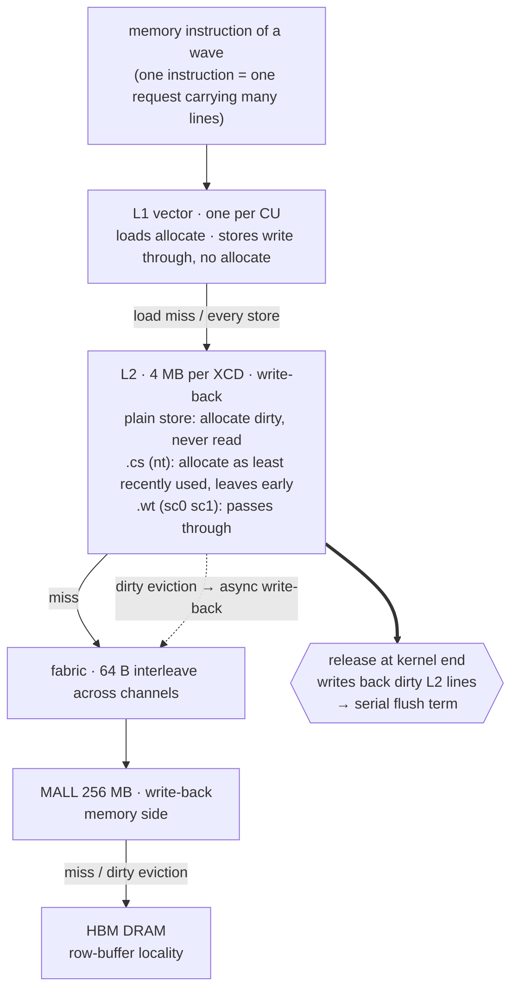
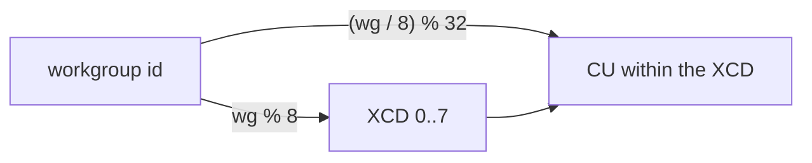
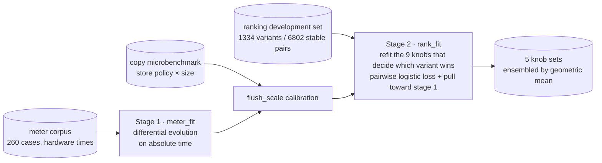
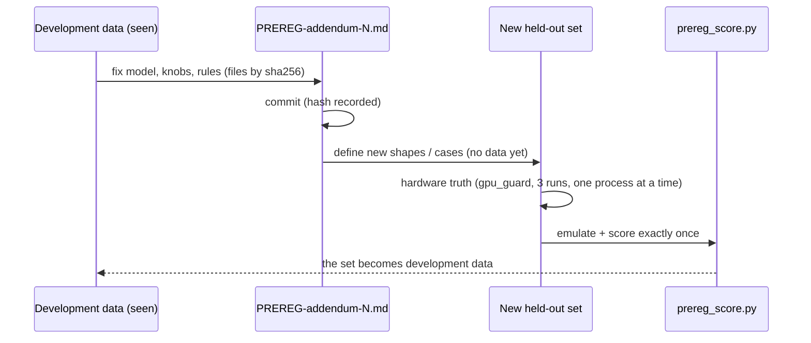

<div align="center">

# ⚡ rocjitsu-perf

### Rank AMD GPU kernel variants without a GPU

**Functional emulation × event-driven timing model × two-stage calibration × pre-registered validation**

-ed1c24)


</div>

---

## 🧭 Contents

- [What it is](#-what-it-is)
- [System design](#-system-design)
- [How it works](#-how-it-works)
- [Capabilities and evidence](#-capabilities-and-evidence)
- [Limitations](#-limitations)
- [Quick start](#-quick-start)
- [How claims are validated](#-how-claims-are-validated)
- [Code and data](#-code-and-data)
- [Roadmap](#-roadmap)

---

## ✨ What it is

[rocjitsu](https://github.com/ROCm/rocm-systems/tree/develop/emulation/rocjitsu) is a **functional emulator** for AMD GPUs. Unmodified PyTorch, Triton and hipBLASLt programs run on the CPU and compute correct results.

This project adds a **calibrated, validated timing model** on top of it, to answer one practical question:

> **Given N implementations of the same operation, which one is fastest, without touching a GPU?**

| 🟢 Good at | 🔴 Not good at |
|---|---|
| Ranking variants of one operation (GEMM 87–90%, Triton 74–80% pairwise) | Absolute runtime (median error 18–24%) |
| Shortlisting candidates (median pick regret typically 1–4%) | Replacing hardware autotuning outright (rare confident misses) |
| Steering an agent or developer without a GPU | Fine-grained store / cache-policy decisions |
| Explaining bottlenecks (L2 and fabric traffic match hardware counters) | Other GPUs (needs recalibration) |

---

## 🏗 System design

### Architecture

```mermaid
flowchart LR
    subgraph APP["🧑‍💻 Unmodified application"]
        P["PyTorch / Triton / hipBLASLt<br/>Python program"]
    end

    subgraph RJ["🧪 rocjitsu: functional emulation"]
        K["LD_PRELOAD<br/>KFD / HSA emulation"]
        CP["Command processor<br/>AQL dispatch"]
        VM["Functional VM<br/>8 XCD × 36 CU<br/>waves execute every instruction"]
    end

    subgraph TP["⏱ Timing plane"]
        COL["Collector<br/>instruction stream → timing events"]
        CU["CU model (DES)<br/>issue ports, scoreboard,<br/>wait counters"]
        MEM["Memory hierarchy (DES)<br/>L1 → L2 → fabric → MALL → DRAM"]
        DD["Dispatch model<br/>bandwidth ledger + composition"]
    end

    subgraph CAL["🎯 Calibration and prediction"]
        TR[("timing trace<br/>one JSON line per dispatch")]
        RC["recompose()<br/>composition + knobs"]
        FIT[("calibrated knobs<br/>5 fits")]
        PRED["predicted cycles<br/>geometric mean of 5 fits"]
    end

    subgraph USE["📊 Uses"]
        RANK["variant ranking / picking"]
        AG["agent feedback"]
        DIAG["bottleneck diagnosis"]
    end

    P --> K --> CP --> VM
    VM -- "retired instructions<br/>+ lane addresses" --> COL
    COL --> CU --> MEM
    CU --> DD
    MEM --> DD
    DD --> TR --> RC
    FIT --> RC --> PRED
    PRED --> RANK & AG
    TR --> DIAG
```



### Memory hierarchy and write policy



### Workgroup placement (as the SPI does it)



> hipBLASLt XCC remapping and Triton GROUP_M both assume this placement. Get it wrong and tiles that share data land on different XCD L2s; GEMV fabric traffic came out 2–4× the hardware counters.

---

## 🔬 How it works

### 1. Functional emulation decides *what* happens

The emulator runs the **compiled binary**, not the source. The timing plane therefore sees:

- the code Triton actually generated and the hipBLASLt solution actually chosen;
- cache-modifier bits (`sc0 / sc1 / nt`);
- the real address of every lane.

### 2. An event-driven timing plane decides *how long*

- **One request per memory instruction, not per cache line.** Each cache level splits a request into hits and misses, and only the misses travel on, which keeps the event count tractable.
- **CU side:** issue ports, a register scoreboard, and `s_waitcnt` counters.
- **Memory side:** occupancy (bandwidth) and hit latency at every level, with a row-buffer model in DRAM.
- **Placement:** timed CUs map one-to-one onto functional XCD/CU slots, and L2s are per XCD.

### 3. Composition turns terms into cycles per dispatch

```
cycles = fixed
       + max( issue , bandwidth , placement )
       + latency
       + filling
       + flush
```

| term | meaning |
|---|---|
| `fixed` | launch, invalidate and end costs |
| `issue` | busiest CU issue work, port- and occupancy-aware |
| `bandwidth` | busiest instance of any level: busiest(bytes) / rate |
| `placement` | command-processor workgroup placement rate |
| `latency` | critical path minus what other resident waves hide, times rounds |
| `filling` | ramp from an empty machine to steady state |
| `flush` | release write-back of dirty L2 lines, serial, at the slower of fabric / MALL |

### 4. Two-stage calibration



> **Why a second stage?** The corpus constrains absolute time, not which of two variants wins. Knobs such as the LDS and MFMA weights and the stall / latency split varied 20× to 2000× across seeds. Stage 2 pins them on ranking data. Cross-validated by group, it lifts GEMM pairwise accuracy from 84.8% to 88.8% and cuts pick regret from 15.1% to 5.3%.

### 5. Determinism

| setting | why |
|---|---|
| `cpu_thread_budget: 1` | several dispatch threads deliver waves to the shared caches in a different order each run (±10–20%) |
| `setarch -R` | with dirty lines in the caches, where buffers land changes set conflicts |

With both, results are bit-for-bit reproducible, and one thread is also about 2.5× faster than the default.

---

## 📈 Capabilities and evidence

### 🥇 Variant ranking (pre-registered held-out sets, each scored once)

Pairwise accuracy is how often the model orders two variants correctly when hardware separates them by more than 10%.

```
GEMM    held-out 4   ████████████████████████████████████░░░░  89.0%
        held-out 5   ███████████████████████████████████░░░░░  87.4%
        held-out 6   ████████████████████████████████████░░░░  89.2%
        best rule    ██████████████████████████░░░░░░░░░░░░░░  60-68%

Triton  held-out 4   ███████████████████████████████░░░░░░░░░  78.7% *
        held-out 5   ███████████████████████████████░░░░░░░░░  79.4%
        └ store-policy softmax ████████████████████████████████████░░░░  90.0%
        best rule    ███████████████████████░░░░░░░░░░░░░░░░░  58-60%

hardware ceiling     ███████████████████████████████████████░  98-100%
```

<sub>best rule = the best rule that needs no timing model (fewer instructions, or fewer DRAM bytes). * after a labelled re-measurement, see [the ranking README](../tests/corpus/ranking/README.md).</sub>

### 🎯 Picking the fastest

| held-out set | model pick regret (median / mean) | hipBLASLt Default |
|---|---|---|
| 4 | **4.0%** / 9.2% | 27.9% / 20.0% |
| 5 | 14.2% / 17.0% | 11.2% / 12.3% |
| 6 | **0.8%** / 8.0% | 12.4% / 12.6% |

➡️ **Usually right, occasionally confidently wrong.** Use it to shortlist, then confirm on hardware.

### 🤖 Agent end to end: GPU-free feedback gets close to hardware feedback

Task: Triton softmax [8192, 1536] bf16, 15 evaluations per agent. Every final kernel was then measured on guarded hardware.

| feedback | mean speedup | worst |
|---|---|---|
| 🖥 hardware | **2.69×** | 2.61× |
| 🧪 **emulator (write-back model)** | **2.58×** | **2.49×** |
| 🙈 none | 2.36× | 1.97× |
| 🧪 emulator (old model × instruction count) | 1.97× | 1.84× |

Agents with emulator feedback discovered the `.cs` / `.wt` store hints on their own. (The evaluation harness for this experiment is kept outside the tree.)

> ⚠️ Lesson: **never hand an optimizer a proxy like model × instruction count.** Agents cut instructions and got slower kernels.

### 🩺 Bottleneck diagnosis

- Each dispatch reports issue, latency, per-level bandwidth and flush, plus bytes per level.
- Fabric bytes track hardware counters with Spearman **0.96–0.97**, and L2 traffic **0.86–1.00**.

---

## 🚧 Limitations

| | status |
|---|---|
| ⏱ absolute runtime | median error 18–24% on the corpus |
| 🎲 final pick | mean regret is not reliably better than Default (long tail) |
| 💾 store / cache policy | hardware cost changes regime around 64–80 MB of working set; one flush scale cannot express it (held-out 5, H3 failed) |
| 🧮 GEMM LDS / MFMA weights | poorly identified; a listwise loss overfit them (held-out 6, H1 / H2 failed) |
| 🌐 other GPUs | calibrated on MI355X only |

---

## 🚀 Quick start

> Paths are relative to `emulation/rocjitsu`. Measurements are written under `$RANKING_WORK`, never into the tree.

```bash
BIN=build/tools/rocjitsu/rocjitsu
CFG=configs/gfx950_mi355x_kmd_timing.json   # write-back caches; set "cpu_thread_budget": 1 for determinism
T=tests/corpus/ranking
```

**1. Run any program under the emulator and get a timing trace**

```bash
ROCJITSU_TIMING_TRACE=trace.jsonl setarch x86_64 -R $BIN --config $CFG -- python3 my_program.py
```

Each line of `trace.jsonl` is one dispatch (`kernel`, `cycles`, `instructions`, bytes and cycles per level, `flush`, ...). `meter_refit.recompose(dispatch, knobs)` turns it into calibrated cycles.

**2. Ranking benchmark: enumerate, measure, emulate, score**

```bash
export RANKING_WORK=$HOME/ranking ROCJITSU_BIN=$BIN ROCJITSU_CONFIG=$CFG
cd $RANKING_WORK
python3 $T/gemm_solutions.py enumerate --workdir tunable --out candidates.json --hip 5
python3 $T/select.py
python3 $T/time_hw_runs.py $RANKING_WORK/hw 1:5 2:6 3:7          # guarded hardware truth
setarch x86_64 -R python3 $T/time_emu.py $RANKING_WORK/emu 48      # emulator
python3 $T/prereg_score.py gemm --hw hw --emu emu --fits "fit-s*.json" --warm-only
```

**3. Hardware measurements always go through the GPU guard**

```bash
python3 $T/gpu_guard.py run --hip 5 --record out.guard.json -- CMD...
```

<details>
<summary><b>Recalibrating</b></summary>

```bash
# Stage 1: corpus fit, seeds 1..5
python3 tests/corpus/meter_fit.py --shards ... --traces ... --real ... --seed 1 --out stage1-s1.json
# flush_scale: fitted separately on a store-policy microbenchmark (kept outside this tree)
# Stage 2: ranking development groups; cross-validate first with --folds 5
python3 $T/rank_fit.py --dev gemm:hw:emu triton:triton_hw:triton_emu --fits "stage1-s*.json" --out-prefix fit
```

</details>

---

## 🧾 How claims are validated



| set | tested | outcome |
|---|---|---|
| 1 | placement and cache-hash fixes | GEMM accuracy ✅ / Triton accuracy ❌ |
| 2 | combined predictor (model^w × instructions^(1−w)) | ✅✅ |
| 3 | write-back model vs previous model | H1 ✅, H3 ✅ (GEMM +2.9, Triton +12.5) |
| 4 | second calibration stage | GEMM all ✅ (+7.1), Triton gain ❌ |
| 5 | flush recalibrated on the size sweep | target H3 ❌ (+1.0, not significant) |
| 6 | listwise loss + defer to Default | accuracy ✅, regret ❌ |

Failures are reported, not retried.

---

## 🗂 Code and data

| what | where |
|---|---|
| timing plane | `lib/rocjitsu/src/rocjitsu/vm/timing/` (collector, CU and cache models, dispatch composition) |
| machine description | `configs/gfx950_mi355x_kmd_timing.json` (shape only; measured values arrive as an overlay) |
| composition mirror and corpus fit | `tests/corpus/meter_refit.py`, `tests/corpus/meter_fit.py` |
| ranking benchmark, second stage, pre-registrations | `tests/corpus/ranking/` (`rank_fit.py`, `prereg_score.py`, `PREREG*.md`, results in its README) |
| behavioural tests | `tests/timing/timing_model_test.cpp` |
| measurements, traces, knob files, the agent experiment | under `$RANKING_WORK`, never in the tree |

---

## 🗺 Roadmap

- [ ] **Quantify shortlist savings:** how often the top 1/3/5 contain the hardware best (existing data, no new measurement)
- [ ] **Stabilise GEMM picks:** constrain stage-2 knobs (tighter bounds, stronger regularisation, more seeds)
- [ ] **Store-policy regimes:** write-only / read-only / mixed sweeps to explain the 64–80 MB boundary
- [ ] **Other GPUs:** new corpus, ranking data and counters

<div align="center">
<sub>MI355X · gfx950 · ROCm 7.2.1 · Triton 3.8 · PyTorch 2.10</sub>
</div>
