<div align="center">

# ⚡ rocjitsu-perf

### Rank AMD GPU kernel variants without a GPU

**Functional emulation × event-driven timing model × two-stage calibration × pre-registered validation**

-ed1c24)


</div>

---

## 🧭 Contents

- [What it is](#-what-it-is)
- [System design](#-system-design)
- [How it works](#-how-it-works)
- [Capabilities and evidence](#-capabilities-and-evidence)
- [Examples on real cases](#-examples-on-real-cases)
- [Limitations](#-limitations)
- [Quick start](#-quick-start)
- [How claims are validated](#-how-claims-are-validated)
- [Code and data](#-code-and-data)
- [Roadmap](#-roadmap)

---

## ✨ What it is

[rocjitsu](https://github.com/ROCm/rocm-systems/tree/develop/emulation/rocjitsu) is a **functional emulator** for AMD GPUs. Unmodified PyTorch, Triton and hipBLASLt programs run on the CPU and compute correct results.

This project adds a **calibrated, validated timing model** on top of it, to answer one practical question:

> **Given N implementations of the same operation, which one is fastest, without touching a GPU?**

| 🟢 Good at | 🔴 Not good at |
|---|---|
| Ranking variants of one operation (GEMM 87–90%, Triton 74–80% pairwise) | Absolute runtime (median error 18–24%) |
| Shortlisting candidates (median pick regret typically 1–4%) | Replacing hardware autotuning outright (rare confident misses) |
| Steering an agent or developer without a GPU | Fine-grained store / cache-policy decisions |
| Explaining bottlenecks (L2 and fabric traffic match hardware counters) | Other GPUs (needs recalibration) |

---

## 🏗 System design

### Architecture

<p align="center">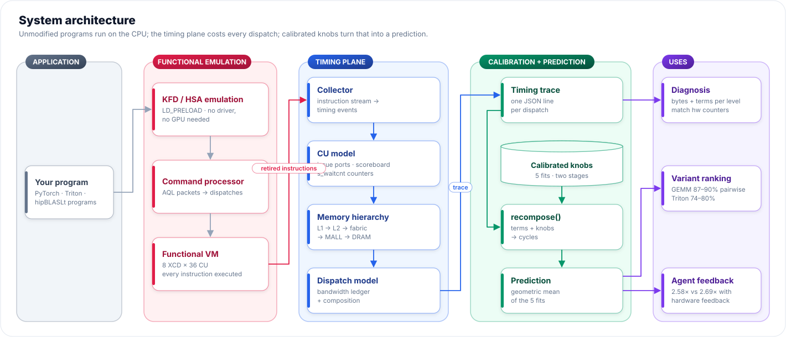</p>

### Memory hierarchy and write policy

<p align="center">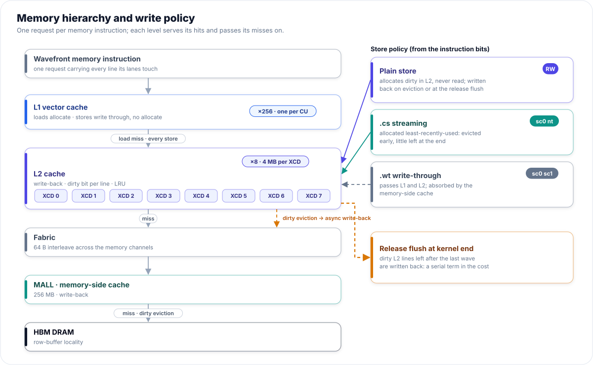</p>

### Workgroup placement (as the SPI does it)

<p align="center">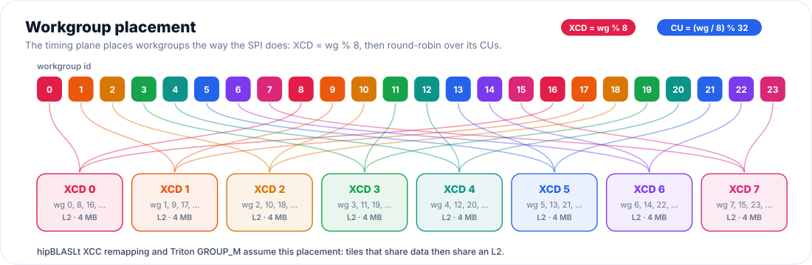</p>

> hipBLASLt XCC remapping and Triton GROUP_M both assume this placement. Get it wrong and tiles that share data land on different XCD L2s; GEMV fabric traffic came out 2–4× the hardware counters.

---

## 🔬 How it works

### The idea in one paragraph

Ranking asks much less of a timing model than absolute time does. Variants of one operation run on the same machine, on the same data, through the same launch path. Most of the errors of a timing model (clock behaviour, launch overhead, how efficiently DRAM is used) are therefore shared by all of them, and they cancel when two predictions are compared.

What *separates* variants is a short list of things:

- how many instructions they issue, and to which units;
- how many bytes each cache level has to move, and on which instance;
- how many wavefronts fit on a CU to hide latency;
- whether their stores leave dirty lines behind.

The emulator runs the real compiled binary, so it observes all of these exactly. The timing model only has to weigh them against each other correctly. Where variants differ in something the model does not represent, the errors stop cancelling, and that is where it misses ([example 2](#2-where-it-misses)).

### From program to ranking, step by step

| # | step | what happens | output |
|---|---|---|---|
| 1 | **Run** | The unmodified program runs under rocjitsu. An emulated kernel driver hands every kernel launch to the functional VM, which executes the GPU binary on the CPU. | correct results |
| 2 | **Observe** | The functional VM reports each instruction it retires to the timing plane: its class (vector ALU, MFMA, LDS, scalar, vector memory, barrier, `s_waitcnt`, …), the registers it reads and writes, and, for memory instructions, the address of every lane and the cache-policy bits. | instruction stream |
| 3 | **Time each wavefront** | A per-wavefront clock advances through issue ports and stops at `s_waitcnt` until data arrives ([§2](#2-timing-one-wavefront)). | issue work, stalls, critical paths |
| 4 | **Time each memory access** | The request walks L1 → L2 → fabric → MALL → HBM; each level has tags, a latency and a queue ([§3](#3-timing-one-memory-access)). | completion times, bytes per level |
| 5 | **Compose** | At the end of the dispatch the terms are combined into cycles and written to the trace ([§4](#4-from-events-to-one-number-per-dispatch)). | one trace line per dispatch |
| 6 | **Calibrate** | `recompose(terms, knobs)` reapplies the composition offline with fitted multipliers ([§6](#6-calibration-why-two-stages)). | predicted µs |
| 7 | **Rank** | Take the geometric mean over 5 knob sets, on warm calls only, and sort. | ranking and pick |

### 1. Functional and timing are separate

The functional VM decides **what** happens: values, branches, addresses. The timing plane decides only **how long** it takes, and nothing it computes flows back into the program. Two consequences follow:

- A wrong timing estimate can never produce a wrong result. The timing plane also needs no data: its caches hold tags only.
- Timing sees the code that really runs:
  - the instructions Triton generated;
  - the hipBLASLt solution that was actually chosen;
  - the `sc0 / sc1 / nt` bits of each store;
  - the real address of every lane.

### 2. Timing one wavefront

<p align="center">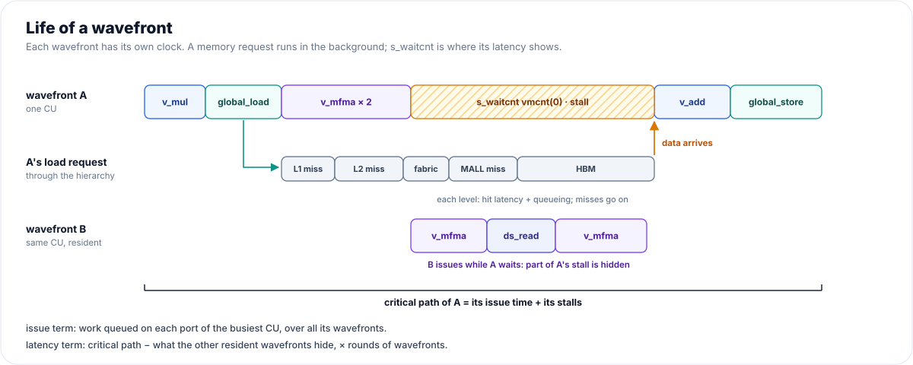</p>

Every wavefront has its own cycle counter.

- **Ordinary instruction.** It waits until its source registers are ready (a register scoreboard). It then takes a slot on the issue port of its unit (vector ALU, matrix, LDS, scalar, vector memory, …) and advances the counter by its issue cost. When several wavefronts of one CU use the same port, they queue for it.
- **Memory instruction.** The addresses of the lanes are coalesced into the cache lines they touch and sent as **one request**. The wavefront does **not** wait for it. Like the hardware, it keeps issuing independent instructions.
- **`s_waitcnt`.** If the data it waits for has not arrived, the counter jumps forward to the arrival time. That jump is a **stall**.

Each wavefront ends with a **critical path**: its issue time plus its stalls. Each CU ends with the **work queued on each of its ports**. These two numbers become the latency and issue terms.

### 3. Timing one memory access

- **Hits and misses.** Each level looks the lines of the request up in a set-associative tag array (LRU, hashed set index). Hits are answered at that level, and only the misses go on to the next one.
- **Latency.** A level answers once two conditions hold:
  - the hit latency of the level has passed since the request was issued;
  - it has worked through the requests queued ahead of this one.

  An access therefore costs its unloaded latency plus congestion, and nothing else.
- **Bytes.** Every line that crosses a level is charged to the instance that served it:
  - L1: per CU;
  - L2: per XCD;
  - fabric, MALL and HBM: per memory channel, with a 64 B interleave.

  The busiest instance later sets the bandwidth term. Traffic that hashes onto a few channels is therefore slower than the same traffic spread out.
- **Placement decides which L2.** Workgroup `wg` runs on XCD `wg % 8`, and each XCD has its own L2. Tiles that share data and sit on one XCD hit in one L2. Spread across XCDs, each XCD fetches its own copy over the fabric.
- **Stores follow their policy bits.**
  - A plain store allocates a dirty line in L2. The line is written back when it is evicted, or at the end of the kernel.
  - A `.cs` (streaming) store is allocated least-recently-used. It is evicted, and so written back, while the kernel is still running.
  - A `.wt` (write-through) store passes L1 and L2. The MALL absorbs it during the kernel.

### 4. From events to one number per dispatch

```
cycles = fixed + max(issue, bandwidth, placement) + latency + filling + flush
```

Why this shape:

- **Issue, bandwidth and placement are throughput limits.** The GPU works against all three at the same time, so the slowest one sets the pace and the other two overlap with it. Hence the `max`.
- **Latency is what that throughput cannot hide.** It adds on top.
- **The release flush can only start after the last wavefront.** It adds too.

| term | what it measures | large when |
|---|---|---|
| `fixed` | launch, cache invalidate, end of kernel | always present (about 1.2–1.4 µs) |
| `issue` | the most loaded issue port of the busiest CU, with each unit weighted | many instructions per CU; MFMA- or LDS-heavy code |
| `bandwidth` | bytes on the busiest instance of any level ÷ the rate of that level | data movement dominates, or traffic piles onto one L2 or channel |
| `placement` | how fast the command processor can launch workgroups | huge grids of tiny workgroups |
| `latency` | exposed stall time of the worst CU (below) | few wavefronts per CU; long chains of dependent loads |
| `filling` | the ramp from an idle machine to every CU busy | always small; matters only for short kernels |
| `flush` | dirty L2 lines written back after the last wavefront, at the slower of fabric and MALL | plain stores still sitting in L2 at the end |

The latency term follows the timeline above. While one wavefront stalls, the other resident wavefronts on its CU issue their own work:

```
hidden  = (resident − 1) × issue work per wavefront
exposed = max(critical path − hidden, stall / stall_overlap)
latency = exposed × ⌈wavefronts on the CU / resident⌉
```

The last line counts rounds: a CU holding more wavefronts than fit at once runs them in rounds, and pays the exposed time once per round. The latency term is also never less than one round trip to the deepest level the traffic reached.

### 5. A worked example

<p align="center">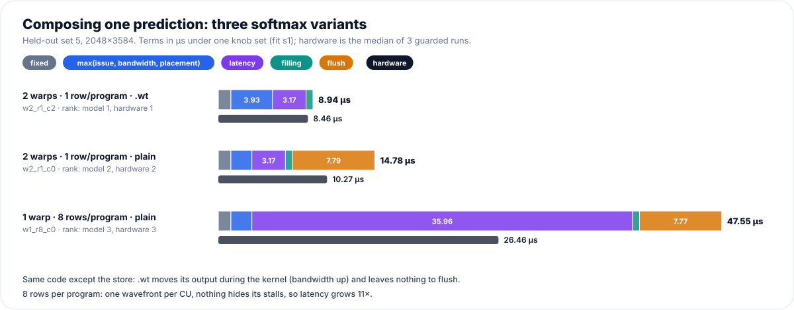</p>

The figure shows three variants of a 2048×3584 softmax from held-out set 5, which the model had not seen. Terms are in µs under one of the five knob sets (fit s1). Hardware is the median of 3 guarded runs.

| variant | fixed | max(issue, bw, place) | latency | filling | flush | **predicted** | **hardware** |
|---|---|---|---|---|---|---|---|
| 2 warps · 1 row/program · `.wt` | 1.19 | 3.93 (bandwidth) | 3.17 | 0.65 | 0 | **8.95** | **8.46** |
| 2 warps · 1 row/program · plain | 1.19 | 1.98 (bandwidth) | 3.17 | 0.65 | 7.79 | **14.79** | **10.27** |
| 1 warp · 8 rows/program · plain | 1.19 | 1.98 (bandwidth) | 35.96 | 0.65 | 7.77 | **47.56** | **26.46** |

How to read it:

- **Store policy (rows 1 and 2).** The two variants have the same code apart from the store, so their issue and latency terms are identical.
  - With plain stores, 14.7 MB of output is still dirty in L2 when the last wavefront ends. Writing it back is a serial 7.8 µs.
  - With `.wt`, the same bytes cross the fabric during the kernel. The bandwidth term doubles (1.98 → 3.93 µs), but it overlaps with the work and nothing is left to flush.

  The model predicts 40% less time for `.wt`; hardware measures 18% less.
- **Rows per program (rows 2 and 3).** Eight rows per program and one warp means 256 wavefronts instead of 4096: one per CU instead of sixteen. Nothing hides the stalls of a wavefront that walks its rows one after another, so the latency term grows 11×.
- **Absolute against relative time.** The predictions are 6% to 80% off in absolute time, yet they order the three variants correctly. The other four knob sets split the time between issue and latency very differently: the issue term of row 2 ranges from 0.1 to 12 µs across them. All five still order the three variants the same way. That disagreement is why the prediction averages five fits, and why calibration has a second stage.

### 6. Calibration: why two stages

The trace records the **raw** terms of every dispatch. `meter_refit.recompose()` reapplies the composition with multipliers (knobs) on each term, unit weight and level rate. Trying a new set of knobs therefore takes milliseconds and never reruns the emulator, and calibration is a search over those knobs.

<p align="center">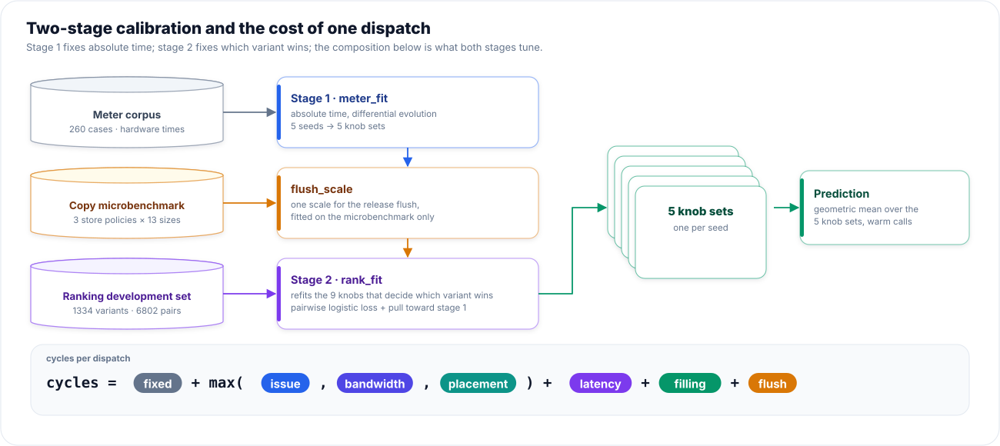</p>

- **Stage 1: absolute time.**
  - Data: the meter corpus, 260 kernels with hardware times.
  - Fit: differential evolution on the log ratio of predicted to measured time. The loss is averaged per kernel category, so 50 elementwise kernels do not outvote 6 quantized ones.
  - Result: 5 seeds give 5 knob sets.
- **The gap.** Absolute time does not pin down the knobs that decide which variant wins. As in the example, many splits between issue and latency fit the corpus equally well. The LDS and MFMA weights varied 20× to 2000× between seeds.
- **Stage 2: ranking.**
  - Data: 1334 development variants in groups, with 6802 stable pairs.
  - Fit: 9 of those knobs are refit with a pairwise logistic loss. For every pair that hardware separates by more than 10%, the penalty grows as the model puts the slower variant first, or puts the two too close.
  - Each group weighs the same, and a pull toward the stage-1 values keeps the absolute calibration.
  - Result, cross-validated by group: GEMM pairwise accuracy rises from 84.8% to 88.8%, and pick regret falls from 15.1% to 5.3%.
- **Flush rate.** The corpus does not identify `flush_scale`, because the fabric rate can compensate for it. It is measured separately, on a store-policy copy microbenchmark.
- **Prediction.** The predicted time of a variant is the geometric mean over the 5 knob sets. Only warm calls count, as in the hardware measurement: the first calls run on cold caches.

### 7. Determinism

| setting | why |
|---|---|
| `cpu_thread_budget: 1` | several dispatch threads deliver waves to the shared caches in a different order each run (±10–20%) |
| `setarch -R` | with dirty lines in the caches, where buffers land changes set conflicts |

With both, results are bit-for-bit reproducible. One thread is also about 2.5× faster than the default.

---

## 📈 Capabilities and evidence

### 🥇 Variant ranking (pre-registered held-out sets, each scored once)

Pairwise accuracy is how often the model orders two variants correctly when hardware separates them by more than 10%.

<p align="center">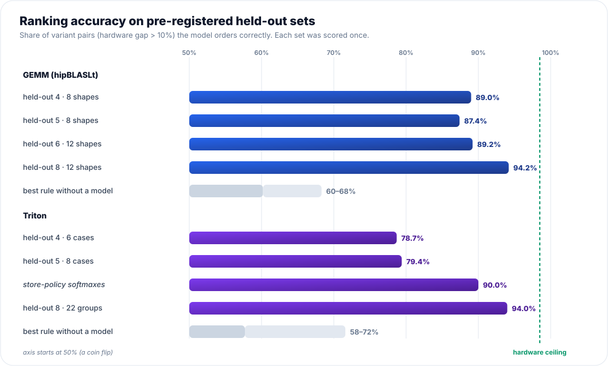</p>

<sub>best rule = the best rule that needs no timing model (fewer instructions, or fewer DRAM bytes). * after a labelled re-measurement, see [the ranking README](../tests/corpus/ranking/README.md).</sub>

### 🎯 Picking the fastest

| held-out set | model pick regret (median / mean) | hipBLASLt Default |
|---|---|---|
| 4 | **4.0%** / 9.2% | 27.9% / 20.0% |
| 5 | 14.2% / 17.0% | 11.2% / 12.3% |
| 6 | **0.8%** / 8.0% | 12.4% / 12.6% |
| 8 | 3.7% / **5.0%** | 3.0% / 11.7% |

➡️ **Usually right, occasionally confidently wrong.** Use it to shortlist, then confirm on hardware.

### 🤖 Agent end to end: GPU-free feedback gets close to hardware feedback

Task: Triton softmax [8192, 1536] bf16, 15 evaluations per agent. Every final kernel was then measured on guarded hardware.

| feedback | mean speedup | worst |
|---|---|---|
| 🖥 hardware | **2.69×** | 2.61× |
| 🧪 **emulator (write-back model)** | **2.58×** | **2.49×** |
| 🙈 none | 2.36× | 1.97× |
| 🧪 emulator (old model × instruction count) | 1.97× | 1.84× |

Agents with emulator feedback discovered the `.cs` / `.wt` store hints on their own. (The evaluation harness for this experiment is kept outside the tree.)

> ⚠️ Lesson: **never hand an optimizer a proxy like model × instruction count.** Agents cut instructions and got slower kernels.

### 🩺 Bottleneck diagnosis

- Each dispatch reports issue, latency, per-level bandwidth and flush, plus bytes per level.
- Fabric bytes track hardware counters with Spearman **0.96–0.97**, and L2 traffic **0.86–1.00**.

---

## 🧪 Examples on real cases

Every example below uses a predictor that had **not seen** the group during calibration, and hardware times measured on MI355X (median of 3 guarded runs). The figures are regenerated by `images/timing-ranking/make_figures.py`.

### 1. Picking a hipBLASLt solution: a win

<p align="center">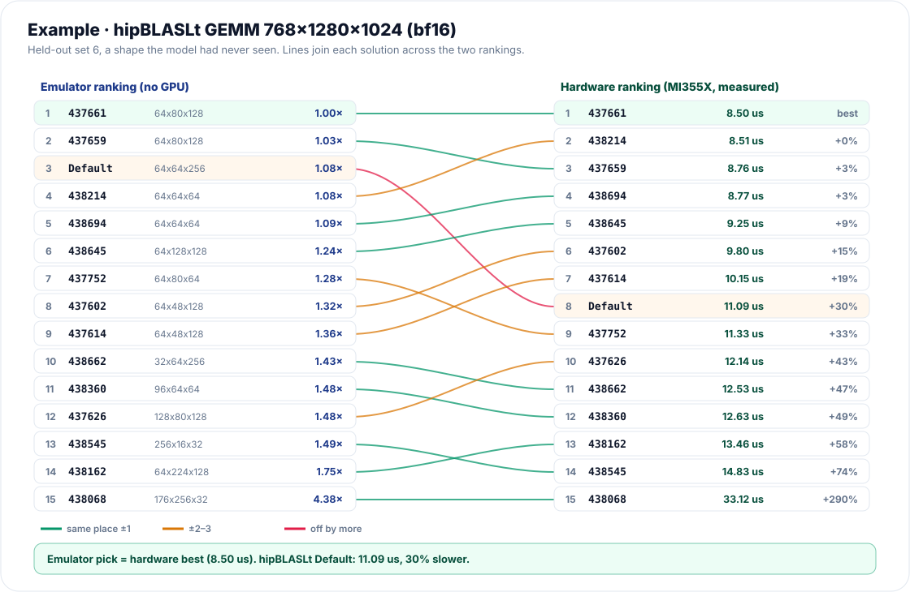</p>

The emulator ranks 15 solutions of a 768×1280×1024 bf16 GEMM without running them on a GPU. Its first choice is the fastest on hardware (8.50 us); hipBLASLt Default is 30% slower. The pathological solution (3.9× slower on hardware) is predicted at 4.4×.

### 2. Where it misses

<p align="center">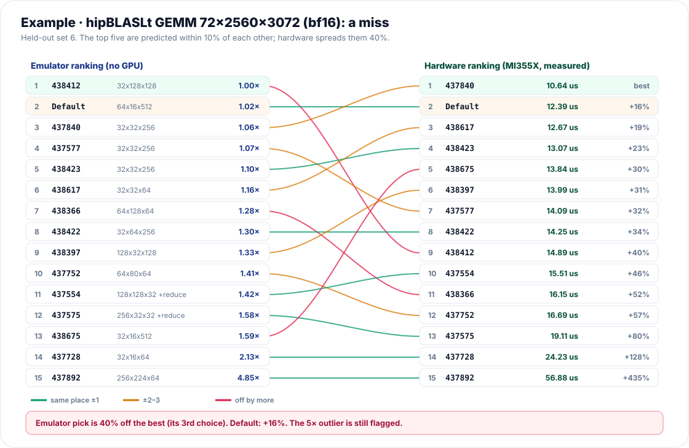</p>

For 72×2560×3072 the model predicts its top five within 10% of each other, while hardware spreads them by 40%. The first choice lands 40% off the best, and the true best is its third choice. The ordering at the bottom (the 5× outlier, the slow split-K kernels) is still right. This is the typical failure: a confident pick inside a region the model sees as flat. It is why the model should shortlist and hardware should confirm.

### 3. Store-policy variants of a Triton softmax

<p align="center">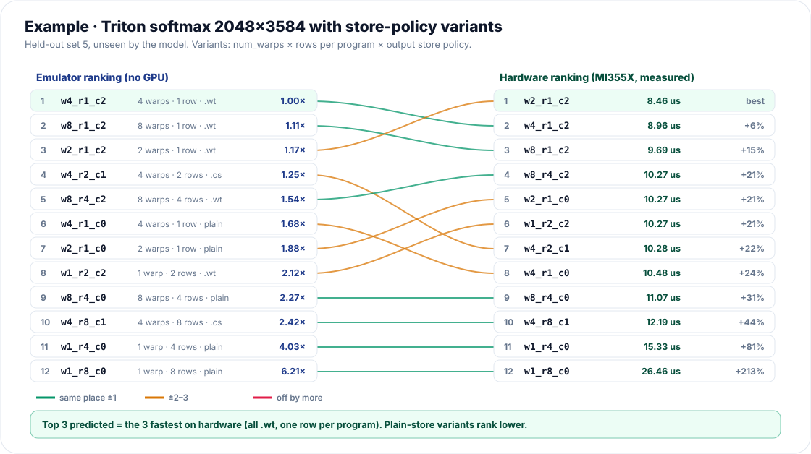</p>

The 12 variants of a 2048×3584 softmax differ in warps, rows per program, and the cache policy of the output store. The model top 3 are exactly the three fastest on hardware: write-through stores, one row per program. Every plain-store variant ranks below them on both sides.

### 4. An agent optimizing without a GPU

<p align="center">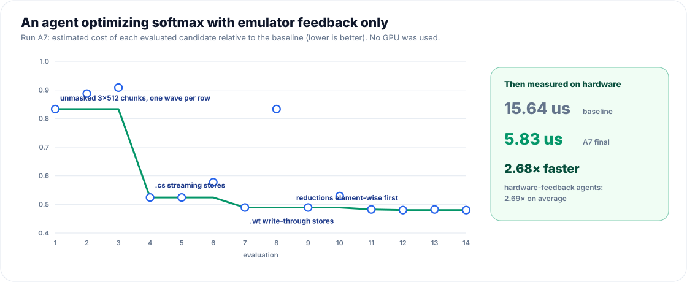</p>

With only the emulator estimate as feedback, the agent removed masked lanes, moved to one wave per row, then found that write-through stores were the largest remaining win. Measured afterwards on hardware, its kernel is 2.68× faster than the baseline. Agents given hardware timings averaged 2.69×.

### 5. Diagnosis that matches the hardware counters

Fabric read traffic of a 1×1024×4096 GEMV, per call, against `TCC_EA0_RDREQ_*`. The first column is from before a request-routing bug in the timing plane was fixed; the traffic comparison is how that bug was found.

| hipBLASLt solution | emulator, before the fix | emulator, after | hardware |
|---|---|---|---|
| Default | 8.57 MB | 8.52 MB | 8.52 MB |
| 437911 | 33.72 MB | 8.51 MB | 8.55 MB |
| 437641 | 33.71 MB | 8.52 MB | 8.57 MB |
| 437890 | 17.24 MB | 8.58 MB | 8.65 MB |
| 437451 | 18.47 MB | 12.37 MB | 12.30 MB |

Bytes written back by the release at the end of a softmax kernel, emulator against `TCC_ALL_TC_OP_WB_WRITEBACK`:

| output store | emulator | hardware |
|---|---|---|
| plain | 16.8 MB | 13.2 MB |
| `.cs` streaming | 1.3 MB | 2.5 MB |
| `.wt` write-through | 0 | 0 |

---

## 🚧 Limitations

| | status |
|---|---|
| ⏱ absolute runtime | median error 12.6% on held-out 8 (90th percentile 33.6%); hipBLASLt GEMM is the weakest family at 16.2% |
| 🎲 final pick | mean regret is not reliably better than Default (held-out 8: 5.0% against 11.7%, but the CI still crosses 0) |
| 💾 store / cache policy | hardware cost changes regime around 64–80 MB of working set; one flush scale cannot express it (held-out 5, H3 failed) |
| 🧮 GEMM LDS / MFMA weights | poorly identified; a listwise loss overfit them (held-out 6, H1 / H2 failed) |
| 🌐 other GPUs | calibrated on MI355X only |

---

## 🚀 Quick start

> Paths are relative to `emulation/rocjitsu`. Measurements are written under `$RANKING_WORK`, never into the tree.

```bash
BIN=build/tools/rocjitsu/rocjitsu
CFG=configs/gfx950_mi355x_kmd_timing.json   # write-back caches; set "cpu_thread_budget": 1 for determinism
T=tests/corpus/ranking
```

**1. Run any program under the emulator and get a timing trace**

```bash
ROCJITSU_TIMING_TRACE=trace.jsonl setarch x86_64 -R $BIN --config $CFG -- python3 my_program.py
```

Each line of `trace.jsonl` is one dispatch (`kernel`, `cycles`, `instructions`, bytes and cycles per level, `flush`, ...). `meter_refit.recompose(dispatch, knobs)` turns it into calibrated cycles.

**2. Ranking benchmark: enumerate, measure, emulate, score**

```bash
export RANKING_WORK=$HOME/ranking ROCJITSU_BIN=$BIN ROCJITSU_CONFIG=$CFG
cd $RANKING_WORK
python3 $T/gemm_solutions.py enumerate --workdir tunable --out candidates.json --hip 5
python3 $T/select.py
python3 $T/time_hw_runs.py $RANKING_WORK/hw 1:5 2:6 3:7          # guarded hardware truth
setarch x86_64 -R python3 $T/time_emu.py $RANKING_WORK/emu 48      # emulator
python3 $T/prereg_score.py gemm --hw hw --emu emu --fits "fit-s*.json" --warm-only
```

**3. Hardware measurements always go through the GPU guard**

```bash
python3 $T/gpu_guard.py run --hip 5 --record out.guard.json -- CMD...
```

<details>
<summary><b>Recalibrating</b></summary>

```bash
# Stage 1: corpus fit, seeds 1..5
python3 tests/corpus/meter_fit.py --shards ... --traces ... --real ... --seed 1 --out stage1-s1.json
# flush_scale: fitted separately on a store-policy microbenchmark (kept outside this tree)
# Stage 2: ranking development groups; cross-validate first with --folds 5
python3 $T/rank_fit.py --dev gemm:hw:emu triton:triton_hw:triton_emu --fits "stage1-s*.json" --out-prefix fit
```

</details>

---

## 🧾 How claims are validated

<p align="center">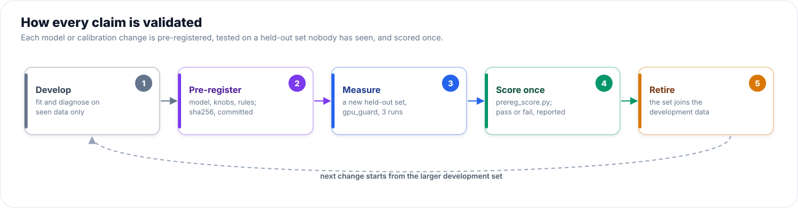</p>

| set | tested | outcome |
|---|---|---|
| 1 | placement and cache-hash fixes | GEMM accuracy ✅ / Triton accuracy ❌ |
| 2 | combined predictor (model^w × instructions^(1−w)) | ✅✅ |
| 3 | write-back model vs previous model | H1 ✅, H3 ✅ (GEMM +2.9, Triton +12.5) |
| 4 | second calibration stage | GEMM all ✅ (+7.1), Triton gain ❌ |
| 5 | flush recalibrated on the size sweep | target H3 ❌ (+1.0, not significant) |
| 6 | listwise loss + defer to Default | accuracy ✅, regret ❌ |
| 8 | LDS-permute fix, measured overlay, absolute-time fit | H1 ✅ H2 ✅ H3 ❌ H4 ✅ H5 ✅ A1 ✅ A2 ✅ (GEMM +3.6, Triton +12.2; absolute median error 12.6%) |

Failures are reported, not retried.

---

## 🗂 Code and data

| what | where |
|---|---|
| timing plane | `lib/rocjitsu/src/rocjitsu/vm/timing/` (collector, CU and cache models, dispatch composition) |
| machine description | `configs/gfx950_mi355x_kmd_timing.json` (shape only; measured values arrive as an overlay) |
| composition mirror and corpus fit | `tests/corpus/meter_refit.py`, `tests/corpus/meter_fit.py` |
| ranking benchmark, second stage, pre-registrations | `tests/corpus/ranking/` (`rank_fit.py`, `prereg_score.py`, `PREREG*.md`, results in its README) |
| behavioural tests | `tests/timing/timing_model_test.cpp` |
| measurements, traces, knob files, the agent experiment | under `$RANKING_WORK`, never in the tree |

---

## 🗺 Roadmap

- [ ] **Quantify shortlist savings:** how often the top 1/3/5 contain the hardware best (existing data, no new measurement)
- [ ] **Stabilise GEMM picks:** constrain stage-2 knobs (tighter bounds, stronger regularisation, more seeds)
- [ ] **Store-policy regimes:** write-only / read-only / mixed sweeps to explain the 64–80 MB boundary
- [ ] **Other GPUs:** new corpus, ranking data and counters

<div align="center">
<sub>MI355X · gfx950 · ROCm 7.2.1 · Triton 3.8 · PyTorch 2.10</sub>
</div>
